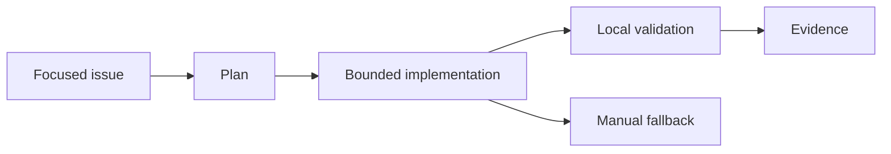

# Challenge 009: Pass Using Only Copilot Free

<div class="lab-meta">
  <span><strong>Level:</strong> <span class="level-badge level-200">L200</span></span>
  <span><strong>Type:</strong> Challenge</span>
  <span><strong>Time:</strong> ~60 min</span>
  <span><strong>Cost:</strong> <span class="level-badge cost-free">Free · GH</span></span>
</div>

## Scenario

You have no paid plan, cloud subscription, or organization features. Complete a realistic repository task using only the current Copilot Free allowance and local validation.

## Objective

Create a plan that spends no money, avoids paid-only dependencies, and proves the change with local tests.



## Rules

- Use automatic model selection.
- Use focused context and Plan before Agent.
- Do not require cloud agent, enterprise AI Controls, or paid model selection.
- Keep a fallback that can be completed manually if the allowance is exhausted.

## Task

Fill `copilot_free_plan.json`: choose a context strategy, four execution steps, local validation commands, and a manual fallback. Then run the validator.

| File | Purpose |
|---|---|
| `copilot_free_plan.json` | Starter plan |
| `test_copilot_free_plan.py` | Acceptance tests |
| `validate_copilot_free_plan.py` | Completion-code generator |

```bash
python -m unittest test_copilot_free_plan.py
python validate_copilot_free_plan.py
```

## Acceptance Criteria

- [ ] plan is explicitly free
- [ ] automatic model selection is enabled
- [ ] at least four bounded steps exist
- [ ] validation is local
- [ ] a manual fallback exists

<div class="challenge-validator" data-answer="CH009-FREE2026">
  <input type="text" aria-label="Completion code" placeholder="CH009-XXXXXXXX" />
  <button type="button">Validate</button>
  <p class="challenge-validator-result" aria-live="polite"></p>
</div>

## Related Labs

- [Lab 107](../labs/lab-107-how-copilot-works.md)
- [Lab 085](../labs/lab-085-copilot-prompt-context-engineering.md)
- [Lab 088](../labs/lab-088-copilot-cli.md)
