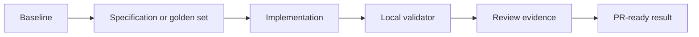

# Challenge 011: Evaluation-Driven RAG

<div class="lab-meta">
  <span><strong>Level:</strong> <span class="level-badge level-300">L300</span></span>
  <span><strong>Type:</strong> Challenge</span>
  <span><strong>Time:</strong> ~90 min</span>
  <span><strong>Cost:</strong> <span class="level-badge cost-free">Free</span></span>
</div>

## Scenario

Improve a local RAG configuration only when the golden-set metrics show a measurable gain without citation regressions.



## Task

1. Complete the starter JSON without changing its public schema.
2. Run the unit tests and inspect every failed assertion.
3. Keep the solution local and deterministic.
4. Run the validator to print the completion code.

## Acceptance criteria

- [ ] Scope, non-goals, risks, and validation are explicit.
- [ ] At least four bounded execution steps are present.
- [ ] Tests run without credentials or GitHub Classroom.
- [ ] Evidence is suitable for a pull-request description.

## Local validation

```bash
cd docs/docs/en/challenges/challenge-011
python -m unittest -v
python validate.py
```

<div class="challenge-validator" data-answer="CH011-EVALRAG">
  <input type="text" aria-label="Completion code" placeholder="CH011-XXXXXXXX" />
  <button type="button">Validate</button>
  <p class="challenge-validator-result" aria-live="polite"></p>
</div>

## Related labs

- [Lab 090](../labs/lab-090-copilot-testing-legacy-modernization.md)
- [Lab 096](../labs/lab-096-agentic-devops-capstone.md)
- [Lab 099](../labs/lab-099-llm-evaluations.md)
- [Lab 022](../labs/lab-022-rag-github-models-pgvector.md)
