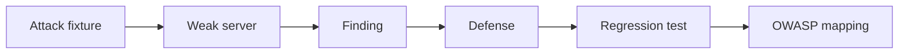

# Challenge 012: Harden an MCP Server

<div class="lab-meta">
  <span><strong>Level:</strong> L300</span>
  <span><strong>Time:</strong> ~90 min</span>
  <span><strong>Cost:</strong> Free</span>
</div>

## Scenario

Attack a deliberately weak local MCP-style server, defend it with explicit controls, then map each finding to OWASP guidance.



## Task

1. Run the attack fixtures
2. Implement schema, authorization, rate, and output controls
3. Prove negative cases
4. Map evidence to OWASP

## Acceptance criteria

- [ ] All local tests pass
- [ ] Each attack has a named control
- [ ] No secret or network access is required
- [ ] The report maps attack → defense → OWASP

## Local validation

```bash
cd docs/docs/en/challenges/challenge-012
python -m unittest -v
python validate.py
```

<div class="challenge-validator" data-answer="CH012-HARDENMCP">
  <input type="text" aria-label="Completion code" placeholder="CH012-XXXXXXXX" />
  <button type="button">Validate</button>
  <p class="challenge-validator-result" aria-live="polite"></p>
</div>

## Official sources

- [OWASP Top 10 for Agentic Applications](https://genai.owasp.org/)
- [MCP 2026-07-28 authorization](https://modelcontextprotocol.io/specification/2026-07-28/basic/authorization)
