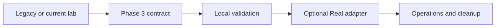

---
tags:
- copilot-studio
- teams
- free-trial
- no-code
lab:
  id: '011'
  level: L100
  journey: m365-agents
  time_min: 30
  cost:
    tier: free
    requires: []
    estimate_usd: 0 within the documented free path or quota.
    simulation: false
    cleanup: false
  status: active
  last_verified: '2026-10-27'
  languages:
  - en
  - pt
  - fr
---
# Lab 011: Copilot Studio — First Agent

<div class="lab-meta">
  <span><strong>Level:</strong> <span class="level-badge level-100">L100</span></span>
  <span><strong>Path:</strong> <a href="../paths/agent-builder-teams/">Agent Builder — Teams</a></span>
  <span><strong>Time:</strong> ~30 min</span>
  <span><strong>💰 Cost:</strong> <span class="level-badge cost-free">Free Trial</span> — Microsoft Copilot Studio free trial (no credit card for first 30 days)</span>
</div>

## What You'll Learn

- Navigate the **Copilot Studio** canvas (no-code/low-code agent builder)
- Create a Q&A agent from a knowledge source (FAQ document)
- Test your agent in the built-in chat test panel
- Publish the agent to **Microsoft Teams**
- Understand topics, triggers, and fallback behavior

---

## Introduction

Microsoft Copilot Studio is a graphical, low-code platform for building conversational AI agents without writing code. You define **topics** (conversation flows), connect **knowledge sources**, and publish to Teams, websites, or other channels in minutes.

This lab builds a customer service agent for the fictional **OutdoorGear Inc.** company, grounded in a product FAQ.

---

## Prerequisites

- Microsoft account (free at account.microsoft.com)
- Copilot Studio trial: [copilotstudio.microsoft.com](https://copilotstudio.microsoft.com) → Start free trial
- Microsoft Teams (free personal edition works)

!!! tip "No credit card needed"
    The Copilot Studio free trial lasts 30 days and does not require payment details.

---

## Lab Exercise

### Step 1: Create a new Copilot

1. Go to [copilotstudio.microsoft.com](https://copilotstudio.microsoft.com)
2. Sign in with your Microsoft account
3. Click **Create** → **New agent**
4. Fill in:
   - **Name:** `OutdoorGear Assistant`
   - **Description:** `Customer service agent for OutdoorGear Inc. — answers product and policy questions`
   - **Instructions:** `You are a friendly customer service agent for OutdoorGear Inc. Answer questions about products, return policies, shipping, and warranties. Be concise and helpful.`
5. Click **Create**

### Step 2: Add a knowledge source

1. In the left panel, click **Knowledge**
2. Click **Add knowledge** → **Public website or file**
3. Enter this URL (our sample FAQ):
   ```
   https://raw.githubusercontent.com/lcarli/AI-LearningHub/main/data/knowledge-base.json
   ```
   Or click **Upload file** and paste this content into a `.txt` file first.

!!! tip "Using the knowledge-base.json"
    The `data/knowledge-base.json` file contains 42 documents including product guides, return policies, FAQs, and shipping info — all pre-formatted for RAG.

### Step 3: Test the built-in knowledge

1. Click **Test** in the top-right corner
2. In the chat panel, try these questions:
   - `What is your return policy?`
   - `Do you have waterproof boots?`
   - `How long does shipping take?`
3. The agent should answer from the knowledge source and cite where it found the answer

### Step 4: Create a custom topic

Custom topics let you override AI responses with deterministic flows for specific intents.

1. Click **Topics** in the left panel
2. Click **Add a topic** → **From blank**
3. Name it: `Order Status`
4. Under **Trigger phrases**, add:
   - `Where is my order`
   - `Track my order`
   - `Order status`
   - `What happened to my order`
5. Add a **Message** node:
   ```
   To check your order status, please visit our order portal at outdoorgear.com/orders or call 1-800-OUTDOOR. Have your order number ready!
   ```
6. Add an **End conversation** node
7. Click **Save**

### Step 5: Test the custom topic

In the test panel, type: `Where is my order?`

The agent should use your custom topic flow, not the AI fallback. Notice how deterministic topics take priority over AI generative answers.

### Step 6: Publish to Teams

1. Click **Publish** in the left panel
2. Click **Publish** to make the agent live
3. Click **Channels** → **Microsoft Teams**
4. Click **Turn on Teams**
5. Click **Open agent** — this opens a deep link
6. In Teams, click **Add** to install the agent as an app
7. Start chatting with your OutdoorGear Assistant in Teams!

---

## Copilot Studio Architecture

```
┌─────────────────────────────────────────┐
│          Copilot Studio                 │
│                                         │
│  ┌─────────────┐   ┌─────────────────┐  │
│  │   Topics    │   │  Generative AI  │  │
│  │ (no-code    │   │  (knowledge +   │  │
│  │  flows)     │   │   LLM fallback) │  │
│  └──────┬──────┘   └────────┬────────┘  │
│         │   Topic match?    │           │
│         │ ◄─────────────────┘           │
│         ▼                               │
│     User message                        │
└─────────────────────────────────────────┘
         │
         ▼
  Channels: Teams, Web, Slack, ...
```

**Priority order:**
1. Custom topics (exact trigger match) → deterministic
2. Built-in system topics (escalate, fallback)
3. Generative AI answers from knowledge sources

---

## When to use Copilot Studio vs Pro Code

| Copilot Studio | Pro Code (SK/MCP) |
|----------------|-------------------|
| Business users, no code | Developers |
| Fast prototyping | Complex logic |
| Teams/SharePoint integration | Custom integrations |
| GUI-based flows | Programmatic control |
| Limited customization | Full flexibility |

---

## Next Steps

- **Teams AI Library (code-first Teams bot):** → [Lab 024 — Teams AI Library](lab-024-teams-ai-library.md)
- **Add MCP tools to Copilot Studio:** → [Lab 012 — What is MCP?](lab-012-what-is-mcp.md)

<!-- phase3-modernization:start -->
## Phase 3 modernization

!!! warning "Verified 2026-10-27"
    Use the Microsoft 365 Agents SDK and Agents Toolkit. Validate declarative agents against manifest v1.9. Keep Copilot Studio trial and Agents Playground routes optional and clearly bounded.



- [Microsoft 365 Agents SDK](https://learn.microsoft.com/microsoft-365/agents-sdk/)
- [Microsoft 365 Agents Toolkit](https://learn.microsoft.com/microsoft-365/agents-toolkit/)
- [Declarative agent schema](https://learn.microsoft.com/microsoft-365-copilot/extensibility/declarative-agent-manifest)
<!-- phase3-modernization:end -->
