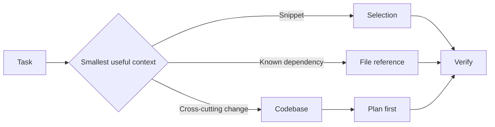

---
tags:
- github-copilot
- prompt-engineering
- context
lab:
  id: '085'
  level: L100
  journey: copilot
  time_min: 45
  cost:
    tier: free-gh
    requires: []
    estimate_usd: 0 within the documented free path or simulation.
    simulation: true
    cleanup: false
  roles:
  - developer
  - student
  technologies:
  - github-copilot
  - prompt-engineering
  - context
  status: active
  last_verified: '2026-10-27'
  languages:
  - en
  - pt
  - fr
---
# Lab 085: Prompt and Context Engineering in GitHub Copilot

  <strong>Level:</strong> L100
  <strong>Journey:</strong> copilot
  <strong>Time:</strong> ~45 min
  <strong>Cost:</strong> GitHub Free

!!! info "Free-first design"
    Complete the guided exercise with Copilot Free or the included simulation. Paid features are optional and explicitly labeled.

!!! tip "AI Credit impact"
    Low for guided work; medium/high for agentic or repeated runs. Prefer automatic model selection, plan before acting, keep context focused, and avoid unnecessary parallel sessions.

## What You'll Learn

- Choose between selection, files, and codebase context
- Write compact prompts with constraints and acceptance criteria
- Use Ask, Plan, and Agent with the right context boundary
- Reduce AI Credit waste by keeping context intentional

## GH-300 alignment

**Responsible AI (15–20%) · Prompt and context (10–15%)**. This mapping follows the GH-300 curriculum snapshot dated **2026-08-07**. The official outline may retain older product wording such as “Copilot Edits”; this lab teaches the current product experience and calls out that difference.

## Concept Map

## Hands-on Exercise

### Step 1: Build a context ladder

Open a small repository and solve the same question four times: with a selection, one referenced file, a focused set of files, and the repository context. Record which evidence changed the answer.

### Step 2: Write an implementation prompt

Use the structure **goal → context → constraints → acceptance criteria → validation**. Ask Plan mode to identify affected files before Agent mode edits anything.

### Step 3: Run the responsible-AI check

Verify generated code, cite the source files used, inspect security-sensitive assumptions, and reject any suggestion that invents APIs or secrets.

