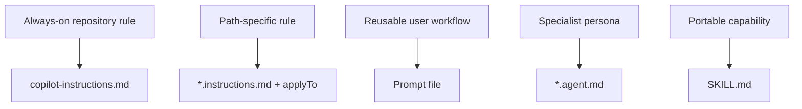

---
tags:
- github-copilot
- custom-instructions
- skills
- agents
lab:
  id: '086'
  level: L200
  journey: copilot
  time_min: 60
  cost:
    tier: free-gh
    requires: []
    estimate_usd: 0 within the documented free path or simulation.
    simulation: true
    cleanup: false
  roles:
  - developer
  - architect
  technologies:
  - github-copilot
  - custom-instructions
  - skills
  - agents
  status: active
  last_verified: '2026-10-27'
  languages:
  - en
  - pt
  - fr
---
# Lab 086: Customize Copilot: Instructions, Prompt Files, Custom Agents, and Skills

  <strong>Level:</strong> L200
  <strong>Journey:</strong> copilot
  <strong>Time:</strong> ~60 min
  <strong>Cost:</strong> GitHub Free

!!! info "Free-first design"
    Complete the guided exercise with Copilot Free or the included simulation. Paid features are optional and explicitly labeled.

!!! tip "AI Credit impact"
    Low for guided work; medium/high for agentic or repeated runs. Prefer automatic model selection, plan before acting, keep context focused, and avoid unnecessary parallel sessions.

## What You'll Learn

- Choose the correct customization artifact
- Scope path-specific instructions with applyTo
- Design reusable prompt files, agents, and SKILL.md packages
- Avoid duplicated or contradictory guidance

## GH-300 alignment

**Use Copilot features (25–30%)**. This mapping follows the GH-300 curriculum snapshot dated **2026-08-07**. The official outline may retain older product wording such as “Copilot Edits”; this lab teaches the current product experience and calls out that difference.

## Concept Map

## Hands-on Exercise

### Step 1: Create repository instructions

Add `.github/copilot-instructions.md` with the invariant rules every contribution must follow. Keep it short, testable, and repository-specific.

### Step 2: Add scoped instructions

Create `.github/instructions/python.instructions.md` with frontmatter `applyTo: "**/*.py"`. Put language-specific rules here instead of the global file.

### Step 3: Package repeatable work

Use a prompt file for a user-invoked workflow, a `*.agent.md` file for a specialist persona with tools, and `SKILL.md` for a portable capability with examples and resources.

### Step 4: Resolve precedence

Inspect `AGENTS.md` and every matching instruction file. Remove duplicates, state conflicts explicitly, and keep tool permissions least-privileged.

