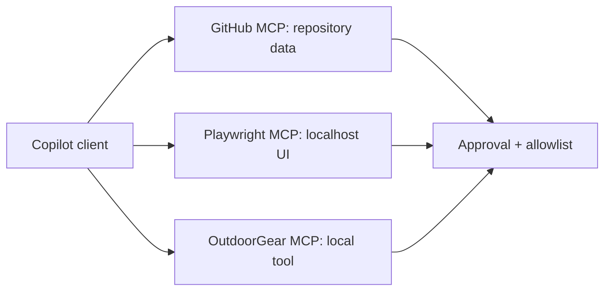

---
tags:
- github-copilot
- mcp
- playwright
- github-mcp-server
lab:
  id: '087'
  level: L200
  journey: copilot
  time_min: 60
  cost:
    tier: free-gh
    requires: []
    estimate_usd: 0 within the documented free path or simulation.
    simulation: true
    cleanup: false
  roles:
  - developer
  - architect
  technologies:
  - github-copilot
  - mcp
  - playwright
  - github-mcp-server
  status: active
  last_verified: '2026-10-27'
  languages:
  - en
  - pt
  - fr
---
# Lab 087: Copilot + MCP: GitHub, Playwright, and Your Own Server

  <strong>Level:</strong> L200
  <strong>Journey:</strong> copilot
  <strong>Time:</strong> ~60 min
  <strong>Cost:</strong> GitHub Free

!!! info "Free-first design"
    Complete the guided exercise with Copilot Free or the included simulation. Paid features are optional and explicitly labeled.

!!! tip "AI Credit impact"
    Low for guided work; medium/high for agentic or repeated runs. Prefer automatic model selection, plan before acting, keep context focused, and avoid unnecessary parallel sessions.

## What You'll Learn

- Connect approved MCP tools to Copilot
- Compare GitHub, Playwright, and local custom servers
- Apply allowlists and read-only tool hints
- Design a minimal tool contract

## GH-300 alignment

**Use Copilot features (25–30%) · Data and architecture (10–15%)**. This mapping follows the GH-300 curriculum snapshot dated **2026-08-07**. The official outline may retain older product wording such as “Copilot Edits”; this lab teaches the current product experience and calls out that difference.

## Concept Map

## Hands-on Exercise

### Step 1: Inventory the servers

List each server, transport, credentials, data boundary, and tool names before connecting it. Prefer the GitHub MCP Registry or a server you can inspect.

### Step 2: Run a read-only GitHub task

Ask Copilot to list issues or inspect repository metadata without changing state. Confirm every tool invocation before expanding permissions.

### Step 3: Run a local Playwright check

Use Playwright MCP only against localhost. Capture an accessibility observation and never send private production data to an unreviewed server.

### Step 4: Reuse Lab 020

Expose one local OutdoorGear lookup tool from Lab 020. Add a strict schema, bounded output, explicit errors, and an allowlist.

## Supporting kit

The site build generates stable PDF and ZIP downloads. The ZIP contains the lab guide and every supporting file declared for this lab.

- [Download generated PDF](../downloads/kits/lab-087-kit-en.pdf)
- [Download generated ZIP](../downloads/kits/lab-087-kit-en.zip)
