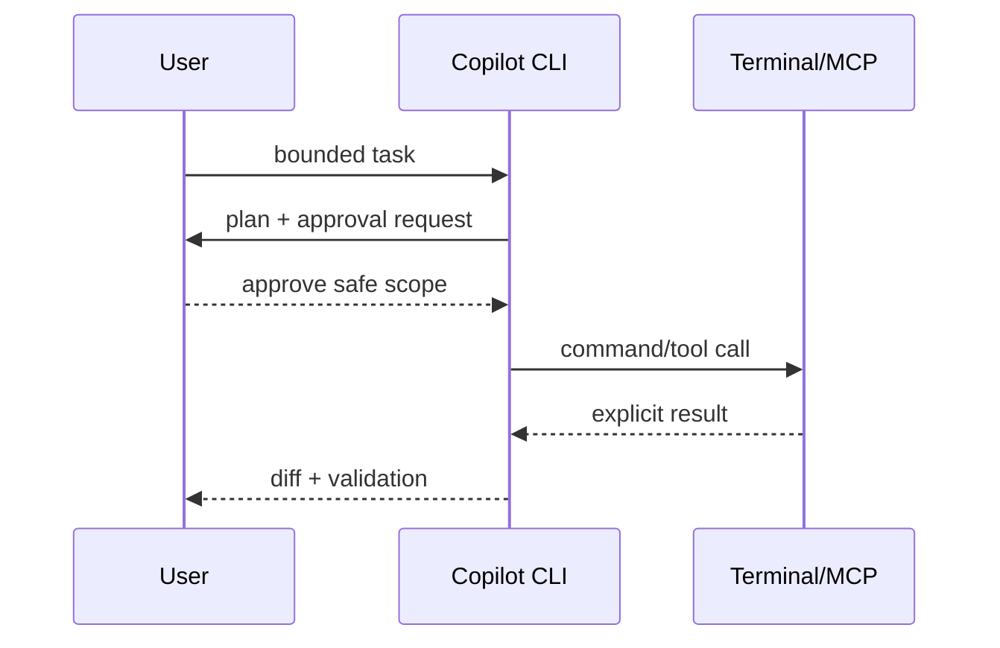

---
tags:
- github-copilot
- copilot-cli
- mcp
- hooks
lab:
  id: '088'
  level: L200
  journey: copilot
  time_min: 60
  cost:
    tier: free-gh
    requires: []
    estimate_usd: 0 within the documented free path or simulation.
    simulation: true
    cleanup: false
  roles:
  - developer
  - devops
  technologies:
  - github-copilot
  - copilot-cli
  - mcp
  - hooks
  status: active
  last_verified: '2026-10-27'
  languages:
  - en
  - pt
  - fr
---
# Lab 088: Copilot CLI: The Agent in Your Terminal

  <strong>Level:</strong> L200
  <strong>Journey:</strong> copilot
  <strong>Time:</strong> ~60 min
  <strong>Cost:</strong> GitHub Free

!!! info "Free-first design"
    Complete the guided exercise with Copilot Free or the included simulation. Paid features are optional and explicitly labeled.

!!! tip "AI Credit impact"
    Low for guided work; medium/high for agentic or repeated runs. Prefer automatic model selection, plan before acting, keep context focused, and avoid unnecessary parallel sessions.

## What You'll Learn

- Install and authenticate the current Copilot CLI
- Use interactive and programmatic workflows
- Configure agents, hooks, MCP, and approvals
- Apply command and policy safety checks

## GH-300 alignment

**Use Copilot features (25–30%)**. This mapping follows the GH-300 curriculum snapshot dated **2026-08-07**. The official outline may retain older product wording such as “Copilot Edits”; this lab teaches the current product experience and calls out that difference.

## Concept Map

## Hands-on Exercise

### Step 1: Install the current CLI

Use the official package (`npm install -g @github/copilot`), WinGet, Homebrew, or the release binary. The retired `gh copilot` extension is not this product.

### Step 2: Start with a read-only prompt

Ask the CLI to explain the repository and propose a validation command. Inspect its plan and every requested permission.

### Step 3: Add controlled automation

Create a custom agent for documentation quality, a pre-command hook that blocks secret-printing commands, and one read-only MCP tool.

### Step 4: Exercise programmatic mode

Produce machine-readable output for a bounded task. Fail the workflow if the CLI proposes an unapproved write or destructive command.

