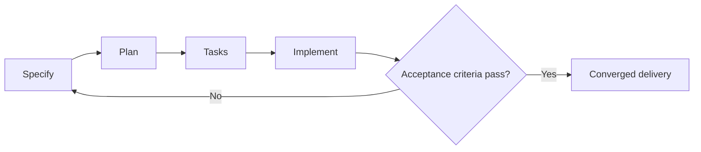

---
tags:
- github-copilot
- spec-kit
- spec-driven-development
lab:
  id: '089'
  level: L200
  journey: copilot
  time_min: 75
  cost:
    tier: free-gh
    requires: []
    estimate_usd: 0 within the documented free path or simulation.
    simulation: true
    cleanup: false
  roles:
  - developer
  - architect
  - student
  technologies:
  - github-copilot
  - spec-kit
  - spec-driven-development
  status: active
  last_verified: '2026-10-27'
  languages:
  - en
  - pt
  - fr
---
# Lab 089: Spec-Driven Development with Spec Kit

  <strong>Level:</strong> L200
  <strong>Journey:</strong> copilot
  <strong>Time:</strong> ~75 min
  <strong>Cost:</strong> GitHub Free

!!! info "Free-first design"
    Complete the guided exercise with Copilot Free or the included simulation. Paid features are optional and explicitly labeled.

!!! tip "AI Credit impact"
    Low for guided work; medium/high for agentic or repeated runs. Prefer automatic model selection, plan before acting, keep context focused, and avoid unnecessary parallel sessions.

## What You'll Learn

- Turn an idea into a testable specification
- Create a plan and dependency-aware task list
- Implement with Copilot without losing traceability
- Converge through tests and evidence

## GH-300 alignment

**Productivity and tests (10–15%)**. This mapping follows the GH-300 curriculum snapshot dated **2026-08-07**. The official outline may retain older product wording such as “Copilot Edits”; this lab teaches the current product experience and calls out that difference.

## Concept Map

## Hands-on Exercise

### Step 1: Specify

Describe the OutdoorGear feature through users, behavior, constraints, non-goals, and measurable acceptance criteria.

### Step 2: Plan

Ask Spec Kit and Copilot to map architecture, affected files, risks, and validation. Review the plan before allowing edits.

### Step 3: Tasks

Split work into independently verifiable tasks and record real dependencies. Every task must trace to an acceptance criterion.

### Step 4: Implement and converge

Execute one task at a time, run the smallest relevant tests, compare the result with the specification, and update artifacts when reality changes.

## Supporting kit

The site build generates stable PDF and ZIP downloads. The ZIP contains the lab guide and every supporting file declared for this lab.

- [Download generated PDF](../downloads/kits/lab-089-kit-en.pdf)
- [Download generated ZIP](../downloads/kits/lab-089-kit-en.zip)
