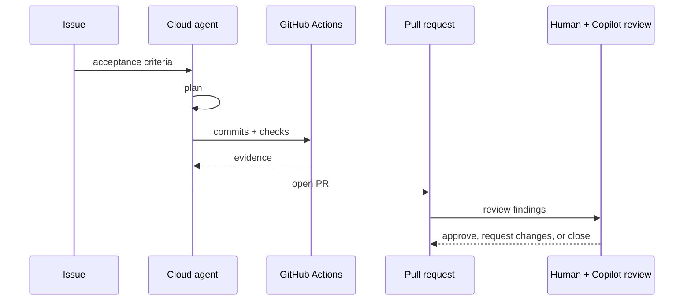

---
tags:
- github-copilot
- cloud-agent
- code-review
- github-actions
lab:
  id: '091'
  level: L300
  journey: copilot
  time_min: 90
  cost:
    tier: paid
    requires: []
    estimate_usd: 0 for simulation; variable for optional paid organization usage.
    simulation: true
    cleanup: true
  roles:
  - developer
  - tech-lead
  - admin
  technologies:
  - github-copilot
  - cloud-agent
  - code-review
  - github-actions
  status: active
  last_verified: '2026-10-27'
  languages:
  - en
  - pt
  - fr
---
# Lab 091: Copilot Cloud Agent and Code Review: From Issue to PR

  <strong>Level:</strong> L300
  <strong>Journey:</strong> copilot
  <strong>Time:</strong> ~90 min
  <strong>Cost:</strong> Paid optional path; complete free simulation included

!!! info "Free-first design"
    Complete the guided exercise with Copilot Free or the included simulation. Paid features are optional and explicitly labeled.

!!! tip "AI Credit impact"
    Low for guided work; medium/high for agentic or repeated runs. Prefer automatic model selection, plan before acting, keep context focused, and avoid unnecessary parallel sessions.

## What You'll Learn

- Trace the issue-to-PR cloud-agent lifecycle
- Review firewall, permissions, and repository instructions
- Evaluate Copilot review comments
- Estimate AI Credits and Actions-minute impact

## GH-300 alignment

**Use Copilot features (25–30%) · Data and architecture (10–15%)**. This mapping follows the GH-300 curriculum snapshot dated **2026-08-07**. The official outline may retain older product wording such as “Copilot Edits”; this lab teaches the current product experience and calls out that difference.

## Concept Map

## Hands-on Exercise

### Step 1: Free simulation: triage the issue

Use the supplied scenario below. Convert a vague issue into acceptance criteria, identify repository instructions, and choose a least-privileged environment.

### Step 2: Free simulation: inspect the session

Review the synthetic timeline: plan, commits, checks, firewall requests, AI Credit band, and review findings. Decide what a human must approve.

### Step 3: Free simulation: review the PR

Classify each Copilot comment as actionable, uncertain, or incorrect. Code review is advisory and does not replace required human approval by default.

### Step 4: Optional paid path

If your organization enables Copilot cloud agent, assign the issue, monitor the live session, review the generated PR, request Copilot review, and record actual AI Credits and Actions minutes.

## Complete Free Simulation

Use this synthetic session record; no Copilot license or organization is required.

| Time | Event | Evidence | Human decision |
|---|---|---|---|
| 09:00 | Issue assigned | Acceptance criteria mention tests and no new dependency | Accept scope |
| 09:03 | Plan proposed | Changes API, tests, and docs | Reject an unrelated database migration |
| 09:08 | Firewall request | Requests `pypi.org` for an unnecessary package | Deny; use the standard library |
| 09:15 | Commit 1 | Implements endpoint, two tests pass | Continue |
| 09:22 | Commit 2 | Adds validation, all six tests pass | Inspect edge cases |
| 09:28 | PR opened | AI Credit band: medium; Actions: 7 minutes | Request review |
| 09:30 | Copilot review | One actionable null check, one speculative performance note | Fix the null check; document why the other is deferred |

Write a short review containing:

1. The least-privileged permissions and network allowlist.
2. The rejected scope and why it was rejected.
3. Which review comment you would apply.
4. A cost record: **medium AI Credits**, **7 Actions minutes**, and the optimization you would try next.
