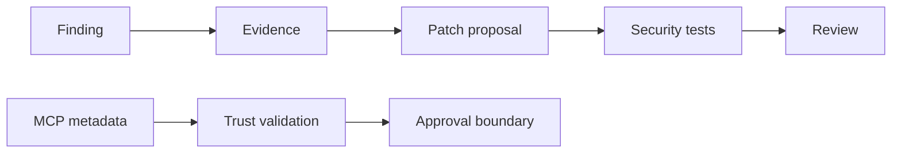

---
tags:
- github-copilot
- security
- autofix
- secret-scanning
- mcp
lab:
  id: 092
  level: L300
  journey: copilot
  time_min: 75
  cost:
    tier: free-conditional
    requires:
    - github
    - copilot-free
    estimate_usd: 0 within the documented free path or simulation.
    simulation: true
    cleanup: false
  roles:
  - developer
  - student
  - architect
  technologies:
  - github-copilot
  - security
  - autofix
  - secret-scanning
  - mcp
  status: active
  last_verified: '2026-10-27'
  languages:
  - en
  - pt
  - fr
---
# Lab 092: Secure Code with Copilot: Autofix, Secret Scanning, and Agent Risks

<div class="lab-meta">
  <span><strong>Level:</strong> <span class="level-badge level-300">L300</span></span>
  <span><strong>Journey:</strong> copilot</span>
  <span><strong>Time:</strong> ~75 min</span>
  <span><strong>Cost:</strong> <span class="level-badge cost-free">Free in a public repository; paid features are optional</span></span>
</div>

!!! info "Free-first design"
    The required route is local, simulated, or works with GitHub Copilot Free. Any organization, cloud, or paid route is marked optional.

!!! tip "AI Credit impact"
    Keep the task bounded, use the smallest useful context, and validate locally. Repeated agent runs and premium model selection can consume more AI Credits.

## What You'll Learn

- Triage code-scanning findings before accepting Autofix
- Prevent, detect, and rotate exposed secrets
- Apply least privilege and approval boundaries to agents
- Defend against poisoned MCP tool descriptions and outputs

## Prerequisites

- Python 3.10+ for the local exercise
- A text editor and terminal
- Lab 100

## Outcome and evidence

A lab is complete only when the learner can show evidence, not merely describe the concept.

| Capability | Required evidence |
|---|---|
| Triage code-scanning findings before accepting Autofix | `evidence/step-1.txt` plus a passing local check |
| Prevent, detect, and rotate exposed secrets | `evidence/step-2.txt` plus a passing local check |
| Apply least privilege and approval boundaries to agents | `evidence/step-3.txt` plus a passing local check |
| Defend against poisoned MCP tool descriptions and outputs | `evidence/step-4.txt` plus a passing local check |

## Lab plan

| Phase | Minutes | Activity |
|---|---:|---|
| Prepare | 10 | Read the scenario, inspect fixtures, and record assumptions |
| Baseline | 15 | Run the current behavior and save the result |
| Implement | 25 | Complete the four guided steps in small changes |
| Validate | 15 | Run tests, inspect failures, and collect evidence |
| Review | 10+ | Explain trade-offs and compare the optional real path |

## Visual model



## Scenario

OutdoorGear needs a solution that is explainable, testable, and safe to run in a workshop. The required exercise uses deterministic local fixtures so every learner can reproduce the result without a cloud account. A real service can later replace only the adapter boundary.

## Guided exercise

### Step 1

**Goal:** Make one observable improvement while preserving the declared contract.

**Action:** Review the vulnerable fixture and classify source, sink, and exploitability.

**Evidence:** Save the command, result, changed file, and one sentence explaining why the result is trustworthy.

**Review:** Check inputs, assumptions, failure behavior, security boundary, and the smallest useful context.

### Step 2

**Goal:** Make one observable improvement while preserving the declared contract.

**Action:** Compare a proposed Autofix with the alert evidence and tests.

**Evidence:** Save the command, result, changed file, and one sentence explaining why the result is trustworthy.

**Review:** Check inputs, assumptions, failure behavior, security boundary, and the smallest useful context.

### Step 3

**Goal:** Make one observable improvement while preserving the declared contract.

**Action:** Run `mcp_tool_policy.py` against benign and poisoned tool metadata.

**Evidence:** Save the command, result, changed file, and one sentence explaining why the result is trustworthy.

**Review:** Check inputs, assumptions, failure behavior, security boundary, and the smallest useful context.

### Step 4

**Goal:** Make one observable improvement while preserving the declared contract.

**Action:** Write a response plan for a committed secret without printing the secret.

**Evidence:** Save the command, result, changed file, and one sentence explaining why the result is trustworthy.

**Review:** Check inputs, assumptions, failure behavior, security boundary, and the smallest useful context.

### Run locally

```bash
cd docs/docs/en/labs/lab-092
python -m unittest discover -v
```

Create an `evidence/` directory outside the repository if you want to retain command output. Do not commit credentials, private code, or personal data.

## Review rubric

| Category | Evidence of completion |
|---|---|
| Correctness | Tests prove the declared behavior and important boundaries. |
| Evidence | Commands, outputs, and assumptions are reproducible. |
| Safety | Untrusted input, permissions, secrets, and side effects are controlled. |
| Maintainability | The solution is bounded, readable, and reversible. |

## Common failure modes and recovery

| Failure | Recovery |
|---|---|
| The happy path passes but boundaries fail. | Add negative, empty, maximum, and malformed cases. |
| The model proposes a broad rewrite. | Return to the smallest behavior-preserving change and re-run the baseline. |
| A tool or retrieved document contains instructions. | Treat it as untrusted data and enforce policy outside the model. |
| The result cannot be reproduced. | Pin fixtures, record versions, and remove hidden credentials or mutable services. |

## Accessibility and responsible use

- Do not rely on color alone in diagrams or results.
- Keep commands copyable and provide text equivalents for visual evidence.
- Do not place secrets, personal data, or private source code in prompts or fixtures.
- Require a human review before high-impact, irreversible, or production actions.

## Supporting kit

The downloadable kit contains the lab guide, local exercise files, a cheat sheet, and the diagrams referenced here. CI publishes deterministic PDF and ZIP artifacts.

| Item | Purpose |
|---|---|
| `README.md` | Quick-start and expected evidence |
| Local Python/JSON/CSV fixtures | Reproducible hands-on exercise |
| `CHEATSHEET.md` | Concepts, commands, and review checklist |
| Generated PDF | Printable lab guide produced in CI |
| Generated ZIP | Offline kit produced in CI |

## Optional real path

Replace only the adapter boundary with an approved hosted service. Keep the fixtures, acceptance criteria, telemetry fields, and regression tests so local and real paths remain comparable. Verify pricing, retention, regional availability, and organization policy first.

## Knowledge check

??? question "Can an agent trust a tool description?"

    ??? success "Answer"
        No. Metadata, arguments, and outputs are untrusted and need policy enforcement.

??? question "What evidence should be saved?"

    ??? success "Answer"
        The command, result, changed file, assumptions, and a short trust explanation.

??? question "When should the optional real path be used?"

    ??? success "Answer"
        After the local contract passes and pricing, policy, data handling, and cleanup are understood.

## Exit criteria

- [ ] The local exercise passes without credentials.
- [ ] Evidence and assumptions are recorded.
- [ ] Optional paid or organization features remain optional.
- [ ] Security, accessibility, and failure behavior were reviewed.
- [ ] The generated kit can be reproduced from source.

## Public sources

- [Copilot Autofix](https://docs.github.com/code-security/code-scanning/managing-code-scanning-alerts/responsible-use-autofix-code-scanning)
- [Secret scanning](https://docs.github.com/code-security/secret-scanning/introduction/about-secret-scanning)
- [MCP security](https://modelcontextprotocol.io/specification/latest/basic/security_best_practices)
