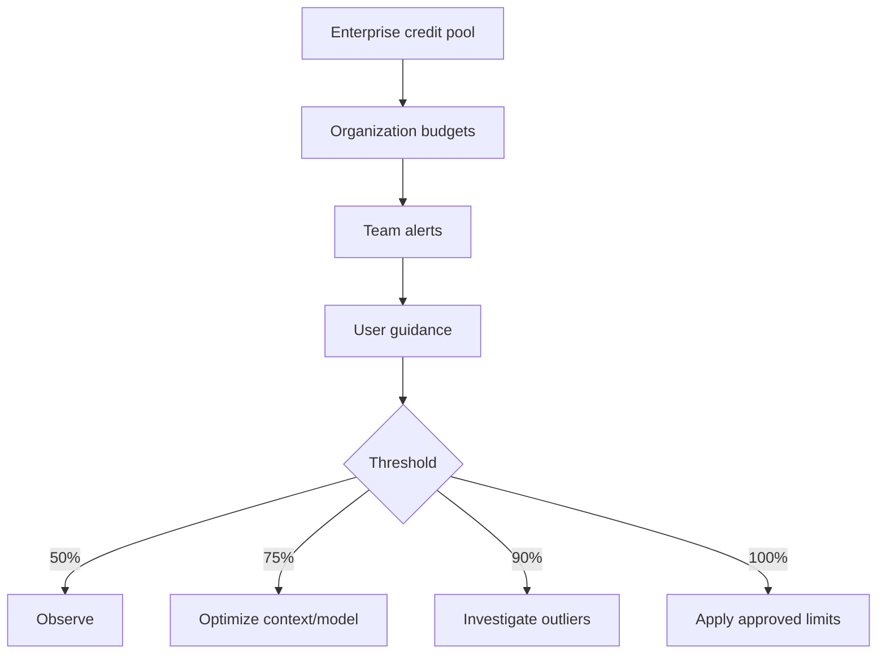

---
tags:
- github-copilot
- ai-controls
- ai-credits
- governance
- finops
lab:
  id: '094'
  level: L300
  journey: enterprise
  time_min: 90
  cost:
    tier: free-conditional
    requires: []
    estimate_usd: 0 within the documented free path or simulation.
    simulation: true
    cleanup: false
  roles:
  - admin
  - architect
  - finops
  - tech-lead
  technologies:
  - github-copilot
  - ai-controls
  - ai-credits
  - governance
  - finops
  status: active
  last_verified: '2026-10-27'
  languages:
  - en
  - pt
  - fr
---
# Lab 094: Copilot Governance and FinOps: AI Controls, Policies, Budgets, and AI Credits

  <strong>Level:</strong> L300
  <strong>Journey:</strong> enterprise
  <strong>Time:</strong> ~90 min
  <strong>Cost:</strong> Free simulation; paid organization path

!!! info "Free-first design"
    Complete the guided exercise with Copilot Free or the included simulation. Paid features are optional and explicitly labeled.

!!! tip "AI Credit impact"
    Low for guided work; medium/high for agentic or repeated runs. Prefer automatic model selection, plan before acting, keep context focused, and avoid unnecessary parallel sessions.

## What You'll Learn

- Map Copilot policies and AI Controls
- Design content exclusion, auditing, and troubleshooting
- Estimate usage in AI Credits without inventing quotas
- Create layered budgets and threshold playbooks

## GH-300 alignment

**Data and architecture (10–15%) · Privacy and safeguards (10–15%)**. This mapping follows the GH-300 curriculum snapshot dated **2026-08-07**. The official outline may retain older product wording such as “Copilot Edits”; this lab teaches the current product experience and calls out that difference.

## Concept Map

## Hands-on Exercise

### Step 1: Free simulation: policy matrix

For each persona, decide whether completions, chat, CLI, MCP, cloud agent, code review, and third-party agents are allowed. Note that enterprise controls do not govern local VS Code agents in the same way.

### Step 2: Free simulation: credit estimator

Classify workloads as low, medium, or high. Estimate `input tokens × input price + output tokens × output price`, then divide USD by 0.01 to express AI Credits. Use current plan docs for real prices.

### Step 3: Design layered budgets

Allocate an enterprise pool, organization guardrails, team alerts, and user guidance. Define actions at 50%, 75%, 90%, and 100%, including investigation before restriction.

### Step 4: Optional paid path

In an authorized enterprise, reproduce the matrix in AI Controls, configure audit retention and an MCP allowlist, then compare actual usage with the simulation.

## Complete Free Governance Simulation

### Policy Matrix

| Persona | CLI | MCP | Cloud agent | Code review | Decision |
|---|---:|---:|---:|---:|---|
| Student | Allow | User-approved local servers | Simulate | Allow if repository enables it | Free-first learning |
| Developer | Allow | Registry allowlist | Selected repositories | Allow | Standard engineering |
| Contractor | Conditional | Block unknown servers | Block | Allow read-only | Restricted data boundary |
| Platform admin | Allow | Manage allowlist | Selected organizations | Allow | Audited administration |

### AI Credit Estimator

Use this transparent scenario:

| Workload | Input tokens | Output tokens | Input price / 1M | Output price / 1M | Estimated USD | AI Credits |
|---|---:|---:|---:|---:|---:|---:|
| Focused chat | 8,000 | 1,000 | $1.00 | $4.00 | $0.012 | 1.2 |
| Repository plan | 60,000 | 4,000 | $1.00 | $4.00 | $0.076 | 7.6 |
| Agent session | 250,000 | 20,000 | $1.00 | $4.00 | $0.330 | 33.0 |

Formula: `USD = input_tokens / 1,000,000 × input_price + output_tokens / 1,000,000 × output_price`; `AI Credits = USD / 0.01`.

These prices are illustrative inputs for the exercise, not a promise of current model pricing. Replace them with the official billing table before a real budget decision.
