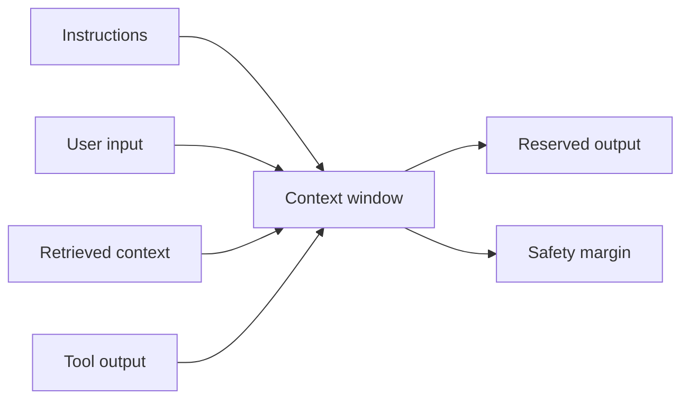

---
tags:
- tokens
- sampling
- context-window
- llm
lab:
  id: '097'
  level: L50
  journey: llm-foundations
  time_min: 30
  cost:
    tier: free
    requires: []
    estimate_usd: 0 within the documented free path or simulation.
    simulation: true
    cleanup: false
  roles:
  - student
  - developer
  - architect
  technologies:
  - tokens
  - sampling
  - context-window
  - llm
  status: active
  last_verified: '2026-10-27'
  languages:
  - en
  - pt
  - fr
---
# Lab 097: Interactive: Tokens, Sampling, and Context Windows

  <strong>Level:</strong> L50
  <strong>Journey:</strong> llm-foundations
  <strong>Time:</strong> ~30 min
  <strong>Cost:</strong> Free

!!! info "Free-first design"
    Complete the guided exercise with Copilot Free or the included simulation. Paid features are optional and explicitly labeled.

!!! tip "AI Credit impact"
    Low for guided work; medium/high for agentic or repeated runs. Prefer automatic model selection, plan before acting, keep context focused, and avoid unnecessary parallel sessions.

## What You'll Learn

- Estimate tokens from text
- Explain temperature, top-k, and top-p
- Budget a context window
- Recognize truncation and context dilution

## GH-300 alignment

**Prompt and context foundations**. This mapping follows the GH-300 curriculum snapshot dated **2026-08-07**. The official outline may retain older product wording such as “Copilot Edits”; this lab teaches the current product experience and calls out that difference.

## Concept Map

## Hands-on Exercise

### Step 1: Estimate tokens

Use the widget below. The estimate uses a transparent approximation, not a model-specific tokenizer. Compare short prose, code, JSON, and accented text.

### Step 2: Explore sampling

Move temperature, top-k, and top-p. Predict whether output becomes more deterministic or diverse, then reveal the explanation.

### Step 3: Budget the window

Allocate system instructions, user input, retrieved context, tool output, and response. Keep a safety margin and remove low-value context first.

## Supporting kit

The site build generates stable PDF and ZIP downloads. The ZIP contains the lab guide and every supporting file declared for this lab.

- [Download generated PDF](../downloads/kits/lab-097-kit-en.pdf)
- [Download generated ZIP](../downloads/kits/lab-097-kit-en.zip)
