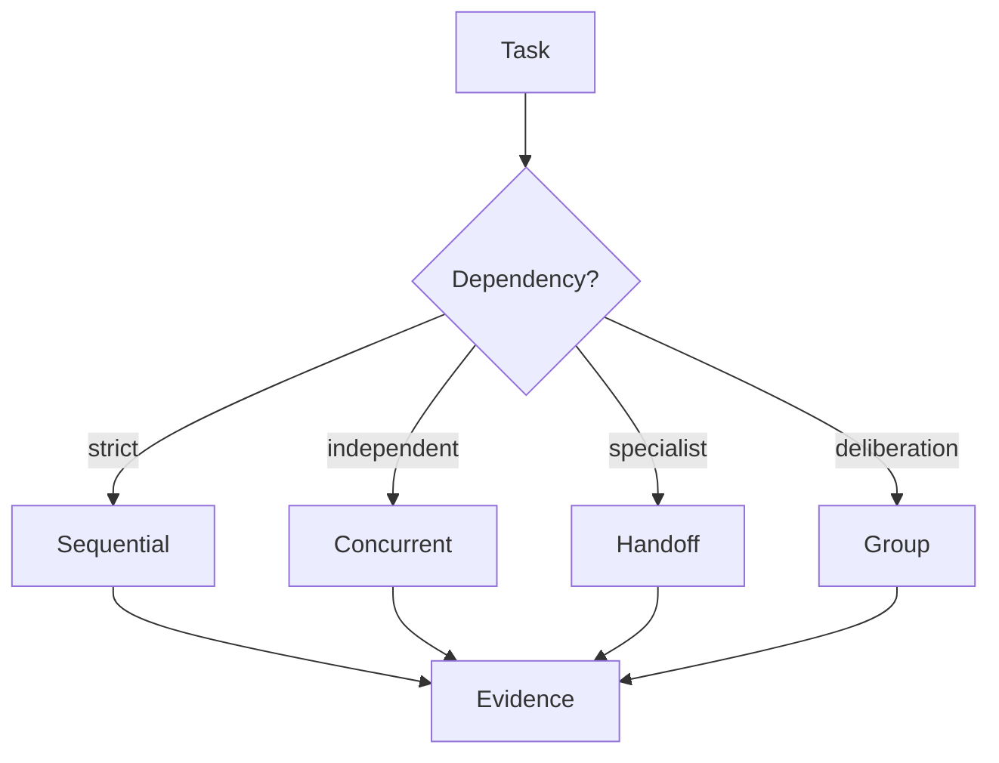

---
tags:
- kit
- local-first
- maf
- phase-3
- quiz
lab:
  id: '106'
  level: L300
  journey: ai-agents
  time_min: 90
  cost:
    tier: free
    requires: []
    estimate_usd: 0 for the local simulation; optional Real usage varies by service
      and must be capped.
    simulation: true
    cleanup: false
  roles:
  - developer
  - architect
  - student
  technologies:
  - maf
  - phase-3
  status: active
  last_verified: '2026-10-27'
  languages:
  - en
  - pt
  - fr
---
# Lab 106: Microsoft Agent Framework: Orchestration Patterns

<div class="lab-meta">
  <span><strong>Level:</strong> <span class="level-badge level-300">L300</span></span>
  <span><strong>Journey:</strong> ai-agents</span>
  <span><strong>Time:</strong> ~90 min</span>
  <span><strong>Cost:</strong> free</span>
</div>

!!! info "Phase 3 · local first"
    The required route is deterministic and local. The Real route is optional and includes an estimate and cleanup.

## What You'll Learn

- Implement sequential, concurrent, handoff, and group patterns
- Use explicit stop and escalation conditions
- Measure coordination cost
- Select the smallest sufficient pattern

## Prerequisites

- Python 3.10+ and a terminal
- No credentials for the required route
- Read the linked official specification before using a hosted adapter

## Visual model



## Scenario

OutdoorGear needs a reviewable workshop implementation with deterministic fixtures, explicit trust boundaries, measurable acceptance criteria, and a reversible optional hosted adapter.

## Guided exercise

### Step 1: `sequential`

1. Run the deterministic fixture for this step.
2. Record the declared input, output, policy decision, and failure behavior.
3. Change one bounded behavior and run the local test again.

**Evidence:** Save the command, result, and one sentence explaining why the evidence is trustworthy.

### Step 2: `concurrent`

1. Run the deterministic fixture for this step.
2. Record the declared input, output, policy decision, and failure behavior.
3. Change one bounded behavior and run the local test again.

**Evidence:** Save the command, result, and one sentence explaining why the evidence is trustworthy.

### Step 3: `handoff`

1. Run the deterministic fixture for this step.
2. Record the declared input, output, policy decision, and failure behavior.
3. Change one bounded behavior and run the local test again.

**Evidence:** Save the command, result, and one sentence explaining why the evidence is trustworthy.

### Step 4: `decision_record`

1. Run the deterministic fixture for this step.
2. Record the declared input, output, policy decision, and failure behavior.
3. Change one bounded behavior and run the local test again.

**Evidence:** Save the command, result, and one sentence explaining why the evidence is trustworthy.

### Run locally

```bash
cd docs/docs/en/labs/lab-106
python -m unittest discover -v
```

## Simulation / Real path

<div class="phase3-path-tabs" data-phase3-tabs>
  <div role="tablist" aria-label="Simulation / Real path">
    <button type="button" role="tab" aria-selected="true" data-phase3-tab="simulation">Simulation</button>
    <button type="button" role="tab" aria-selected="false" data-phase3-tab="real">Real path</button>
  </div>
  <section role="tabpanel" data-phase3-panel="simulation">
    Use the included deterministic fixtures and local validator. Estimated cost: **US$0**.
  </section>
  <section role="tabpanel" data-phase3-panel="real" hidden>
    Replace only the adapter boundary. Set a spending cap before execution, retain the same acceptance tests, and record region, retention, identity, telemetry, and pricing assumptions. Delete hosted deployments, endpoints, indexes, traces, and test data after validation.
  </section>
</div>

## Supporting kit

The site build generates stable PDF and ZIP downloads. CI also keeps a temporary artifact mirror for 30 days.

- [`README.md`](lab-106/README.md): quick start and evidence checklist
- [`CHEATSHEET.md`](lab-106/CHEATSHEET.md): decision and review guide
- [`scenario.json`](lab-106/scenario.json): deterministic exercise contract
- [`test_scenario.py`](lab-106/test_scenario.py): local acceptance tests
- [Download generated PDF](../downloads/kits/lab-106-kit-en.pdf)
- [Download generated ZIP](../downloads/kits/lab-106-kit-en.zip)

## Scored knowledge check

??? question "Why keep a local contract?"

    ??? success "Answer"
        It provides a deterministic baseline before adding hosted variability and cost.

??? question "When is the Real route complete?"

    ??? success "Answer"
        Only after validation evidence and cleanup are recorded.

??? question "How should tool output be treated?"

    ??? success "Answer"
        As untrusted data until policy and schema validation succeed.

## Exit criteria

- [ ] Local tests pass without credentials.
- [ ] The diagram has a text explanation and does not depend on color.
- [ ] The scored quiz was reviewed.
- [ ] The Real path has a cost cap and cleanup plan.
- [ ] Sources and stability status were checked.

## Official public sources

- [Microsoft Agent Framework 1.0 GA](https://devblogs.microsoft.com/agent-framework/microsoft-agent-framework-version-1-0/)
- [AutoGen to Agent Framework migration](https://learn.microsoft.com/agent-framework/migration-guide/from-autogen/)
