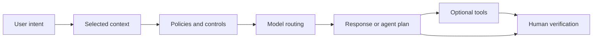

---
tags:
- github-copilot
- ai-credits
- models
- agents
lab:
  id: '107'
  level: L50
  journey: copilot
  time_min: 25
  cost:
    tier: free
    requires: []
    estimate_usd: 0 within the documented free path or simulation.
    simulation: true
    cleanup: false
  roles:
  - student
  - developer
  - admin
  - architect
  technologies:
  - github-copilot
  - ai-credits
  - models
  - agents
  status: active
  last_verified: '2026-10-27'
  languages:
  - en
  - pt
  - fr
---
# Lab 107: How GitHub Copilot Works: Context, Models, Agents, and Data Flow

  <strong>Level:</strong> L50
  <strong>Journey:</strong> copilot
  <strong>Time:</strong> ~25 min
  <strong>Cost:</strong> Free

!!! info "Free-first design"
    Complete the guided exercise with Copilot Free or the included simulation. Paid features are optional and explicitly labeled.

!!! tip "AI Credit impact"
    Low for guided work; medium/high for agentic or repeated runs. Prefer automatic model selection, plan before acting, keep context focused, and avoid unnecessary parallel sessions.

## What You'll Learn

- Describe the Copilot request lifecycle
- Separate context selection from model selection
- Distinguish completions, chat, and agents
- Explain data boundaries, retention, and AI Credits at a conceptual level

## GH-300 alignment

**GH-300 foundation · Data and architecture**. This mapping follows the GH-300 curriculum snapshot dated **2026-08-07**. The official outline may retain older product wording such as “Copilot Edits”; this lab teaches the current product experience and calls out that difference.

## Concept Map

## Hands-on Exercise

### Step 1: Trace a request

Follow editor signals, explicit references, repository instructions, policy checks, model routing, response generation, and user verification.

### Step 2: Compare experiences

Completions predict code locally in your editing flow; chat answers a conversation; agents plan and use tools over multiple steps.

### Step 3: Map data and billing

Document who controls the repository, which context leaves the client, applicable retention and exclusion policies, and which interactions consume AI Credits.

## Supporting kit

The site build generates stable PDF and ZIP downloads. The ZIP contains the lab guide and every supporting file declared for this lab.

- [Download generated PDF](../downloads/kits/lab-107-kit-en.pdf)
- [Download generated ZIP](../downloads/kits/lab-107-kit-en.zip)
