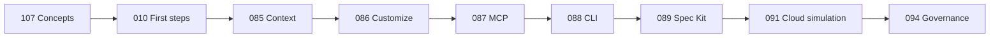

# 🤖 GitHub Copilot Path

L100 L200 L300 L400

Learn the current Copilot workflow: completions, Ask, Plan, Agent, inline chat, MCP, secure approvals, and repository instructions.

## Current Labs

| Lab | Title | Level | Cost |
|-----|-------|-------|------|
| [Lab 010](../../labs/lab-010-github-copilot-first-steps.md) | GitHub Copilot — First Steps | L100 | GRÁTIS·GH |
| [Lab 016](../../labs/lab-016-copilot-agent-mode.md) | Copilot Agent and Plan | L100 | GRÁTIS·GH |
| [Lab 025](../../labs/lab-025-vscode-chat-participant.md) | VS Code Chat Participant | L200 | GRÁTIS·GH |
| [Lab 081](../../labs/lab-081-agentic-coding-tools.md) | Agentic Coding Tools | L100 | GRÁTIS |
| [Lab 085](../../labs/lab-085-copilot-prompt-context-engineering.md) | Prompt and Context Engineering | L100 | FREE · GH |
| [Lab 086](../../labs/lab-086-customize-copilot.md) | Instructions, Prompt Files, Agents, and Skills | L200 | FREE · GH |
| [Lab 087](../../labs/lab-087-copilot-mcp.md) | Copilot + MCP | L200 | FREE · GH |
| [Lab 088](../../labs/lab-088-copilot-cli.md) | Copilot CLI | L200 | FREE · GH |
| [Lab 089](../../labs/lab-089-spec-kit.md) | Spec-Driven Development with Spec Kit | L200 | FREE · GH |
| [Lab 091](../../labs/lab-091-cloud-agent-code-review.md) | Cloud Agent and Code Review | L300 | FREE simulation / PAID real path |
| [Lab 094](../../labs/lab-094-copilot-governance-finops.md) | Governance and FinOps | L300 | FREE simulation |
| [Lab 107](../../labs/lab-107-how-copilot-works.md) | How GitHub Copilot Works | L50 | FREE |

## 2026 Migration Status

- Lab 041 is retired because GitHub App-based Copilot Extensions were discontinued. Use MCP, the VS Code API, or the upcoming Copilot SDK lab.
- Lab 045 is retired because Copilot Workspace was discontinued. Use Plan and Agent today; the roadmap adds a Spec Kit lab.
- Labs 085–094 now cover custom instructions, skills, MCP, CLI, Spec Kit, cloud agent, code review, governance, and FinOps.

## Recommended 2026 Sequence

→ [Follow the four-week GH-300 path](../gh-300/index.md)

## Copilot Free

This path is designed to work with Copilot Free unless a lab is explicitly marked paid or simulated. Copilot Free includes a completion quota and a limited AI Credits allowance; exact availability can change, so labs avoid hardcoded chat or model quotas.

→ [Enable GitHub Copilot Free](https://github.com/features/copilot)

## External Resources

- [GitHub Copilot documentation](https://docs.github.com/copilot)
- [Customize Copilot](https://docs.github.com/copilot/customizing-copilot)
- [Model Context Protocol](https://modelcontextprotocol.io/)
