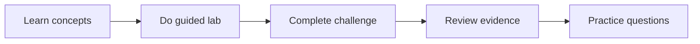

# GH-300 GitHub Copilot Certification Path

A balanced four-week cohort for individual learners and enterprise workshops. Every week includes a free path; organization-only activities are simulations unless clearly marked optional and paid.

!!! warning "2026 terminology"
    The official skills outline dated 2026-08-07 may still mention “Copilot Edits.” Learn the current Ask, Plan, and Agent experiences, but recognize the legacy term for the exam.

## Four-Week Cohort

| Week | Required work | GH-300 emphasis |
|---|---|---|
| Week 1 — Foundations and responsible AI | Labs 107, 010, 085, and 008 | Responsible AI (15–20%); prompt and context (10–15%) |
| Week 2 — Copilot features | Labs 016, 086, 087, and 088 | Use Copilot features (25–30%) |
| Week 3 — Productivity, tests, and safeguards | Labs 089, 090, and 092 | Productivity and tests (10–15%); privacy and safeguards (10–15%) |
| Week 4 — Governance and delivery | Labs 094, 091 (simulation), plus a 50-question practice exam | Data and architecture (10–15%) |

## Cohort Rhythm

Each workshop uses a 90-minute pattern: 15 minutes of concepts, 45 minutes of guided work, 15 minutes of peer review, and 15 minutes of exam-style reflection. Individual learners can split the same work across shorter sessions.

## Free and Enterprise Routes

| Audience | Route |
|---|---|
| Community / student | Copilot Free, local tools, simulations, and public repositories |
| Enterprise workshop | Same free foundation plus optional organization policies, AI Controls, cloud agent, and usage evidence |

## Practice and Exam Readiness

Use the official Microsoft Learn certification page, exam sandbox, and Skills Navigator practice assessment. Treat community question banks as secondary material, never as an official blueprint.

- Explain why an answer is correct, not only which option is correct.
- Rehearse privacy, content exclusion, approvals, and responsible-AI decisions.
- Track weak domains and repeat the linked labs before the final simulation.

## 50-Question Practice Exam

The simulator covers the curriculum through five personas. It stores only the final score in this browser.

## Official Resources

- [GH-300 certification](https://learn.microsoft.com/credentials/certifications/github-copilot/)
- [GitHub Copilot documentation](https://docs.github.com/copilot)
- [Copilot plans](https://docs.github.com/copilot/get-started/plans)
