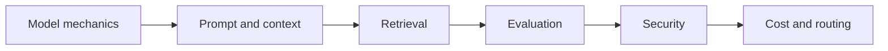

# LLM Foundations 2.0 Path

Build a current, local-first foundation for model behavior, retrieval, evaluation, security, context, and cost.

| Lab | Title | Level | Time |
|---|---|---|---|
| [Lab 004](../../labs/lab-004-how-llms-work.md) | How LLMs Work: Tokens, Attention, Training, and Hallucination | L50 | 45 min |
| [Lab 005](../../labs/lab-005-prompt-engineering.md) | Prompting and Context Engineering | L50 | 60 min |
| [Lab 007](../../labs/lab-007-what-are-embeddings.md) | Embeddings and Local Similarity Search | L50 | 60 min |
| [Lab 017](../../labs/lab-017-structured-output.md) | Reliable Structured Output with Local Validation | L100 | 60 min |
| [Lab 018](../../labs/lab-018-function-calling.md) | Tool Calling with Typed Local Contracts | L100 | 60 min |
| [Lab 019](../../labs/lab-019-streaming-responses.md) | Streaming Responses: Events, Cancellation, and Safe UX | L100 | 50 min |
| [Lab 022](../../labs/lab-022-rag-github-models-pgvector.md) | Local RAG: Chunking → Embedding → Search → Answer | L200 | 90 min |
| [Lab 097](../../labs/lab-097-tokens-sampling-context.md) | Interactive: Tokens, Sampling, and Context Windows | L50 | 30 min |
| [Lab 098](../../labs/lab-098-context-engineering-agents.md) | Context Engineering for Agents | L200 | 75 min |
| [Lab 099](../../labs/lab-099-llm-evaluations.md) | LLM Evaluations 101: Golden Sets, LLM-as-Judge, and CI Regression | L200 | 90 min |
| [Lab 100](../../labs/lab-100-owasp-llm-agentic-threat-modeling.md) | OWASP Top 10 for LLM and Agentic Applications: Threat Modeling | L200 | 75 min |
| [Lab 101](../../labs/lab-101-token-economics.md) | Token Economics: Cost, Cache, Batch, and Routing | L200 | 60 min |

## Free-first route

All required exercises run locally with deterministic fixtures. Hosted embedding, generation, evaluation, and observability services are optional adapters.
