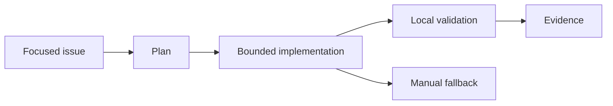

# Défi 009 : réussir uniquement avec Copilot Free

<div class="lab-meta">
  <span><strong>Level:</strong> <span class="level-badge level-200">L200</span></span>
  <span><strong>Type:</strong> Challenge</span>
  <span><strong>Time:</strong> ~60 min</span>
  <span><strong>Cost:</strong> <span class="level-badge cost-free">Free · GH</span></span>
</div>

## Scenario

Vous n'avez ni forfait payant, ni abonnement cloud, ni fonctions d'organisation. Réalisez une tâche réelle avec l'allocation Copilot Free et une validation locale.

## Objective

Créez un plan sans coût, sans dépendance payante et prouvé par des tests locaux.



## Rules

- Utilisez la sélection automatique du modèle.
- Utilisez un contexte ciblé et Plan avant Agent.
- Ne dépendez pas de l'agent cloud, des AI Controls entreprise ou d'une sélection payante.
- Gardez une solution manuelle si l'allocation est épuisée.

## Task

Complétez `copilot_free_plan.json` : stratégie de contexte, quatre étapes, validations locales et solution manuelle. Lancez ensuite le validateur.

| File | Purpose |
|---|---|
| `copilot_free_plan.json` | Starter plan |
| `test_copilot_free_plan.py` | Acceptance tests |
| `validate_copilot_free_plan.py` | Completion-code generator |

```bash
python -m unittest test_copilot_free_plan.py
python validate_copilot_free_plan.py
```

## Acceptance Criteria

- [ ] le plan est explicitement gratuit
- [ ] la sélection automatique est activée
- [ ] au moins quatre étapes bornées existent
- [ ] la validation est locale
- [ ] une solution manuelle existe

<div class="challenge-validator" data-answer="CH009-FREE2026">
  <input type="text" aria-label="Completion code" placeholder="CH009-XXXXXXXX" />
  <button type="button">Validate</button>
  <p class="challenge-validator-result" aria-live="polite"></p>
</div>

## Related Labs

- [Lab 107](../labs/lab-107-how-copilot-works.md)
- [Lab 085](../labs/lab-085-copilot-prompt-context-engineering.md)
- [Lab 088](../labs/lab-088-copilot-cli.md)
