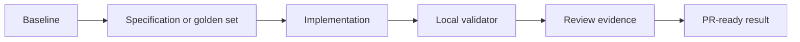

# Challenge 011: RAG guidé par l'évaluation

<div class="lab-meta">
  <span><strong>Niveau:</strong> <span class="level-badge level-300">L300</span></span>
  <span><strong>Type:</strong> Défi</span>
  <span><strong>Durée:</strong> ~90 min</span>
  <span><strong>Coût:</strong> <span class="level-badge cost-free">Gratuit</span></span>
</div>

## Scénario

Améliorez un RAG local seulement si les métriques progressent sans régression des citations.



## Tâche

1. Complétez le JSON initial sans modifier son schéma public.
2. Exécutez les tests et examinez chaque assertion en échec.
3. Conservez une solution locale et déterministe.
4. Exécutez le validateur pour afficher le code de réussite.

## Critères d'acceptation

- [ ] Portée, exclusions, risques et validation sont explicites.
- [ ] Au moins quatre étapes bornées sont présentes.
- [ ] Les tests s'exécutent sans identifiants ni GitHub Classroom.
- [ ] Les preuves conviennent à une description de pull request.

## Validation locale

```bash
cd docs/docs/fr/challenges/challenge-011
python -m unittest -v
python validate.py
```

<div class="challenge-validator" data-answer="CH011-EVALRAG">
  <input type="text" aria-label="Completion code" placeholder="CH011-XXXXXXXX" />
  <button type="button">Validate</button>
  <p class="challenge-validator-result" aria-live="polite"></p>
</div>

## Labs associés

- [Lab 090](../labs/lab-090-copilot-testing-legacy-modernization.md)
- [Lab 096](../labs/lab-096-agentic-devops-capstone.md)
- [Lab 099](../labs/lab-099-llm-evaluations.md)
- [Lab 022](../labs/lab-022-rag-github-models-pgvector.md)
