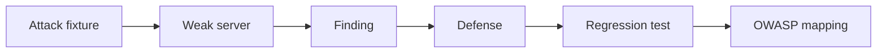

# Challenge 012: Durcir un serveur MCP

<div class="lab-meta">
  <span><strong>Level:</strong> L300</span>
  <span><strong>Time:</strong> ~90 min</span>
  <span><strong>Cost:</strong> Free</span>
</div>

## Scenario

Attaquez un serveur local volontairement faible, défendez-le avec des contrôles explicites puis reliez chaque constat à OWASP.



## Task

1. Exécuter les attaques
2. Implémenter schéma, autorisation, débit et contrôle de sortie
3. Prouver les cas négatifs
4. Relier les preuves à OWASP

## Acceptance criteria

- [ ] Tous les tests locaux passent
- [ ] Chaque attaque a un contrôle nommé
- [ ] Aucun secret ni réseau requis
- [ ] Le rapport relie attaque → défense → OWASP

## Local validation

```bash
cd docs/docs/fr/challenges/challenge-012
python -m unittest -v
python validate.py
```

<div class="challenge-validator" data-answer="CH012-HARDENMCP">
  <input type="text" aria-label="Completion code" placeholder="CH012-XXXXXXXX" />
  <button type="button">Validate</button>
  <p class="challenge-validator-result" aria-live="polite"></p>
</div>

## Official sources

- [OWASP Top 10 for Agentic Applications](https://genai.owasp.org/)
- [MCP 2026-07-28 authorization](https://modelcontextprotocol.io/specification/2026-07-28/basic/authorization)
