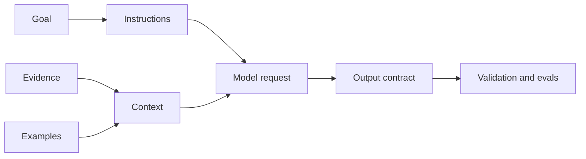

---
tags:
- prompting
- context-engineering
- evaluation
- llm
lab:
  id: '005'
  level: L50
  journey: llm-foundations
  time_min: 60
  cost:
    tier: free
    requires: []
    estimate_usd: 0 within the documented free path or simulation.
    simulation: true
    cleanup: false
  roles:
  - student
  - developer
  - architect
  technologies:
  - prompting
  - context-engineering
  - evaluation
  - llm
  status: active
  last_verified: '2026-10-27'
  languages:
  - en
  - pt
  - fr
---
# Lab 005: Prompting et ingénierie du contexte

<div class="lab-meta">
  <span><strong>Niveau:</strong> <span class="level-badge level-50">L50</span></span>
  <span><strong>Parcours:</strong> llm-foundations</span>
  <span><strong>Durée:</strong> ~60 min</span>
  <span><strong>Coût:</strong> <span class="level-badge cost-free">Gratuit</span></span>
</div>

!!! info "Conception gratuite d'abord"
    Le parcours obligatoire est local, simulé ou compatible avec GitHub Copilot Free. Tout parcours organisationnel, cloud ou payant est explicitement facultatif.

!!! tip "Impact sur les AI Credits"
    Limitez la tâche, utilisez le plus petit contexte utile et validez localement. Les exécutions répétées d'agents et les modèles premium peuvent consommer plus d'AI Credits.

## Ce que vous apprendrez

- Écrire des prompts avec objectif, preuves, contraintes, contrat de sortie et validation
- Séparer instructions durables, contexte de tâche et preuves récupérées
- N'utiliser des exemples que s'ils améliorent un comportement mesurable
- Traiter les prompts comme des composants versionnés et évalués

## Prérequis

- Python 3.10+ pour l'exercice local
- Un éditeur de texte et un terminal
- Lab 098

## Résultat et preuves

Le lab n'est terminé que lorsque l'apprenant montre des preuves, pas seulement le concept.

| Capacité | Preuve requise |
|---|---|
| Écrire des prompts avec objectif, preuves, contraintes, contrat de sortie et validation | `evidence/step-1.txt` plus un contrôle local réussi |
| Séparer instructions durables, contexte de tâche et preuves récupérées | `evidence/step-2.txt` plus un contrôle local réussi |
| N'utiliser des exemples que s'ils améliorent un comportement mesurable | `evidence/step-3.txt` plus un contrôle local réussi |
| Traiter les prompts comme des composants versionnés et évalués | `evidence/step-4.txt` plus un contrôle local réussi |

## Plan du lab

| Phase | Minutes | Activité |
|---|---:|---|
| Préparer | 10 | Lire le scénario, examiner les fixtures et noter les hypothèses |
| Base | 15 | Exécuter le comportement actuel et conserver le résultat |
| Implémenter | 25 | Réaliser les quatre étapes par petites modifications |
| Valider | 15 | Exécuter les tests, examiner les échecs et collecter les preuves |
| Réviser | 10+ | Expliquer les compromis et comparer le parcours réel facultatif |

## Modèle visuel



## Scénario

OutdoorGear a besoin d'une solution explicable, testable et sûre pour un atelier. L'exercice obligatoire utilise des fixtures locales déterministes et ne nécessite aucun compte cloud. Un service réel pourra ensuite remplacer uniquement l'adaptateur.

## Exercice guidé

### Step 1

**Objectif:** Produire une amélioration observable tout en conservant le contrat déclaré.

**Action:** Exécutez `prompt_challenges.py` pour noter des prompts vagues et structurés.

**Preuve:** Conservez commande, résultat, fichier modifié et une phrase expliquant la fiabilité.

**Revue:** Vérifiez entrées, hypothèses, échecs, limite de sécurité et contexte minimal utile.

### Step 2

**Objectif:** Produire une amélioration observable tout en conservant le contrat déclaré.

**Action:** Refactorisez un long prompt en instructions, tâche, contexte, exemples et schéma de sortie.

**Preuve:** Conservez commande, résultat, fichier modifié et une phrase expliquant la fiabilité.

**Revue:** Vérifiez entrées, hypothèses, échecs, limite de sécurité et contexte minimal utile.

### Step 3

**Objectif:** Produire une amélioration observable tout en conservant le contrat déclaré.

**Action:** Supprimez le contexte dupliqué et réservez un budget de sortie.

**Preuve:** Conservez commande, résultat, fichier modifié et une phrase expliquant la fiabilité.

**Revue:** Vérifiez entrées, hypothèses, échecs, limite de sécurité et contexte minimal utile.

### Step 4

**Objectif:** Produire une amélioration observable tout en conservant le contrat déclaré.

**Action:** Créez cinq cas de régression avant toute nouvelle modification.

**Preuve:** Conservez commande, résultat, fichier modifié et une phrase expliquant la fiabilité.

**Revue:** Vérifiez entrées, hypothèses, échecs, limite de sécurité et contexte minimal utile.

### Exécuter localement

```bash
cd docs/docs/fr/labs/lab-005
python -m unittest discover -v
```

Créez un dossier `evidence/` hors du dépôt pour conserver les sorties. Ne commitez ni identifiants, ni code privé, ni données personnelles.

## Grille de revue

| Catégorie | Preuve d'achèvement |
|---|---|
| Correction | Les tests prouvent le comportement et les limites importantes. |
| Preuves | Commandes, résultats et hypothèses sont reproductibles. |
| Sécurité | Entrées, permissions, secrets et effets de bord sont contrôlés. |
| Maintenabilité | La solution est bornée, lisible et réversible. |

## Échecs fréquents et récupération

| Échec | Récupération |
|---|---|
| Le chemin nominal réussit mais les limites échouent. | Ajoutez cas négatifs, vides, maximaux et mal formés. |
| Le modèle propose une réécriture générale. | Revenez au plus petit changement et rejouez la base. |
| Un outil ou document récupéré contient des instructions. | Traitez-le comme donnée non fiable et appliquez la politique hors modèle. |
| Le résultat n'est pas reproductible. | Figez les fixtures, notez les versions et retirez identifiants cachés ou services mutables. |

## Accessibilité et usage responsable

- Ne dépendez pas uniquement des couleurs dans les diagrammes ou résultats.
- Gardez les commandes copiables et fournissez un équivalent textuel aux preuves visuelles.
- Ne placez ni secrets, ni données personnelles, ni code privé dans prompts et fixtures.
- Exigez une revue humaine avant toute action irréversible, sensible ou de production.

## Kit d'accompagnement

Le kit téléchargeable contient le guide, les exercices locaux, une fiche mémo et les diagrammes cités. Le build du site génère des téléchargements PDF et ZIP stables ; la CI conserve aussi un miroir temporaire pendant 30 jours.

| Élément | Objectif |
|---|---|
| [`README.md`](lab-005/README.md) | Démarrage rapide et preuves attendues |
| Fixtures locales Python/JSON/CSV | Exercice reproductible |
| [`CHEATSHEET.md`](lab-005/CHEATSHEET.md) | Concepts, commandes et liste de vérification |
| [PDF généré](../downloads/kits/lab-005-kit-fr.pdf) | Guide imprimable produit en CI |
| [ZIP généré](../downloads/kits/lab-005-kit-fr.zip) | Kit hors ligne produit en CI |

## Parcours réel facultatif

Remplacez uniquement l'adaptateur par un service hébergé approuvé. Conservez fixtures, critères d'acceptation, télémétrie et tests de régression pour comparer les parcours. Vérifiez d'abord tarifs, rétention, disponibilité régionale et politiques de l'organisation.

## Vérification des connaissances

??? question "Quand ajouter du contexte ?"

    ??? success "Réponse"
        Seulement s'il change la réponse ou permet sa vérification.

??? question "Quelles preuves conserver ?"

    ??? success "Réponse"
        Commande, résultat, fichier modifié, hypothèses et brève explication de confiance.

??? question "Quand utiliser le parcours réel facultatif ?"

    ??? success "Réponse"
        Après réussite du contrat local et compréhension des coûts, politiques, données et nettoyage.

## Critères de sortie

- [ ] L'exercice local réussit sans identifiants.
- [ ] Les preuves et hypothèses sont consignées.
- [ ] Les fonctions payantes ou organisationnelles restent facultatives.
- [ ] Sécurité, accessibilité et comportements d'échec ont été vérifiés.
- [ ] Le kit peut être reproduit depuis les sources.

## Sources publiques

- [GitHub Copilot prompt engineering](https://docs.github.com/copilot/concepts/prompt-engineering)
- [VS Code Copilot context](https://code.visualstudio.com/docs/copilot/chat/copilot-chat-context)
