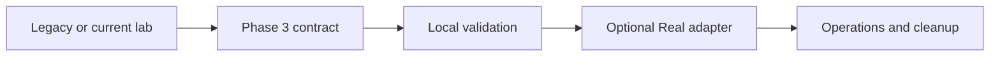

---
tags:
- foundry
- mcp
- azure
- azure-required
lab:
  id: '030'
  level: L300
  journey: microsoft-foundry
  time_min: 90
  cost:
    tier: paid
    requires:
    - paid-service
    estimate_usd: Varies by selected service; see the lab cost section.
    simulation: false
    cleanup: true
  status: active
  last_verified: '2026-10-27'
  languages:
  - en
  - pt
  - fr
---
# Lab 030 : Microsoft Foundry Agent Service + MCP

<div class="lab-meta">
  <span><strong>Niveau :</strong> <span class="level-badge level-300">L300</span></span>
  <span><strong>Parcours :</strong> <a href="../paths/foundry/">Foundry + MCP</a></span>
  <span><strong>Durée :</strong> ~90 min</span>
  <span><strong>💰 Coût :</strong> Abonnement Azure — coûts de tokens gpt-4o-mini</span>
</div>

!!! warning "Abonnement Azure requis"
    Ce lab nécessite un abonnement Azure. → [Guide des prérequis](../prerequisites.md)

## Ce que vous apprendrez

- Déployer un Hub + Projet **Azure AI Foundry** en un clic
- Déployer un point de terminaison de modèle **gpt-4o-mini**
- Créer un **Agent** dans le Foundry Agent Service
- Connecter votre serveur MCP comme outil pour l'agent
- Exécuter une conversation agent de bout en bout avec des appels d'outils

---

## Déployer l'infrastructure

### Option A — Déployer sur Azure (un clic)

[](https://portal.azure.com/#create/Microsoft.Template/uri/https%3A%2F%2Fraw.githubusercontent.com%2Flcarli%2FAI-LearningHub%2Fmain%2Finfra%2Flab-030-foundry%2Fazuredeploy.json)

Ceci déploie :
- Azure AI Foundry Hub
- Projet AI (OutdoorGear Agent Project)
- Compte de stockage + Key Vault (requis par Foundry)

!!! tip "Région recommandée"
    Utilisez **East US** ou **Sweden Central** pour la meilleure disponibilité des modèles.

### Option B — Azure CLI (Bicep)

```bash
git clone https://github.com/lcarli/AI-LearningHub.git && cd AI-LearningHub

az group create --name rg-ai-labs-foundry --location eastus

# Get your user Object ID
USER_OID=$(az ad signed-in-user show --query id -o tsv)

az deployment group create \
  --resource-group rg-ai-labs-foundry \
  --template-file infra/lab-030-foundry/main.bicep \
  --parameters location=eastus userObjectId=$USER_OID
```

---

## Exercice du lab

### Étape 1 : Déployer gpt-4o-mini dans Foundry

1. Allez sur [ai.azure.com](https://ai.azure.com) → votre projet
2. **Catalogue de modèles** → recherchez `gpt-4o-mini` → **Déployer**
3. Nom : `gpt-4o-mini` — gardez les valeurs par défaut
4. Copiez votre **URL de point de terminaison** et votre **clé API** depuis la page de déploiement

### Étape 2 : Démarrer votre serveur MCP

Utilisez le serveur du [Lab 020](lab-020-mcp-server-python.md) ou du [Lab 028](lab-028-deploy-mcp-azure.md). Pour les tests locaux :

```bash
python mcp_product_server.py  # starts on stdio or SSE
```

### Étape 3 : Créer un agent avec le SDK Foundry

```bash
pip install azure-ai-projects azure-identity
```

```python
import os
from azure.ai.projects import AIProjectClient
from azure.identity import DefaultAzureCredential

# Get these from your Foundry project settings
PROJECT_CONNECTION_STRING = os.environ["AZURE_AI_PROJECT_CONNECTION_STRING"]

client = AIProjectClient.from_connection_string(
    credential=DefaultAzureCredential(),
    conn_str=PROJECT_CONNECTION_STRING,
)

# Create the agent
agent = client.agents.create_agent(
    model="gpt-4o-mini",
    name="OutdoorGear Assistant",
    instructions=(
        "You are a helpful customer service agent for OutdoorGear Inc. "
        "Help customers find products, answer policy questions, and assist with orders. "
        "Be friendly, concise, and accurate. "
        "When you don't know something, say so honestly."
    ),
)
print(f"Created agent: {agent.id}")
```

### Étape 4 : Exécuter une conversation

```python
# Create a thread (conversation session)
thread = client.agents.create_thread()

# Add a user message
client.agents.create_message(
    thread_id=thread.id,
    role="user",
    content="Hi! I'm looking for a tent for a winter camping trip to Mt. Rainier. What do you recommend?"
)

# Run the agent
run = client.agents.create_and_process_run(
    thread_id=thread.id,
    assistant_id=agent.id,
)

print(f"Run status: {run.status}")

# Get the response
messages = client.agents.list_messages(thread_id=thread.id)
for msg in messages.data:
    if msg.role == "assistant":
        for content in msg.content:
            if content.type == "text":
                print(f"\n🤖 {content.text.value}")
```

### Étape 5 : Ajouter des outils MCP à l'agent

```python
# For Cloud MCP server (deployed via Lab 028):
agent_with_tools = client.agents.create_agent(
    model="gpt-4o-mini",
    name="OutdoorGear Assistant + Search",
    instructions="You are a helpful outdoor gear assistant. Use the search tool to find products.",
    tools=[
        {
            "type": "mcp",
            "server_label": "outdoorgear",
            "server_url": "https://YOUR-MCP-APP.azurecontainerapps.io/sse",
            "allowed_tools": ["search_products", "get_product", "list_categories"],
        }
    ]
)

# Now the agent can call your MCP server tools automatically
thread2 = client.agents.create_thread()
client.agents.create_message(
    thread_id=thread2.id,
    role="user",
    content="What climbing harnesses are currently in stock?"
)
run2 = client.agents.create_and_process_run(
    thread_id=thread2.id,
    assistant_id=agent_with_tools.id,
)

# Get response (agent will have called MCP tools)
messages2 = client.agents.list_messages(thread_id=thread2.id)
for msg in messages2.data:
    if msg.role == "assistant":
        print(msg.content[0].text.value)
```

---

## Nettoyage

```bash
az group delete --name rg-ai-labs-foundry --yes --no-wait
```

---

## Prochaines étapes

- **Ajouter pgvector pour le RAG :** → [Lab 031 — pgvector sur Azure](lab-031-pgvector-semantic-search.md)
- **Sécurité au niveau des lignes :** → [Lab 032 — RLS pour les agents](lab-032-row-level-security.md)

<!-- phase3-modernization:start -->
## Modernisation de Phase 3

!!! warning "Verified 2026-10-27"
    Utilisez Microsoft Foundry et Agent Service GA fondé sur Responses API. Les évaluations sont GA ; les hosted agents restent en preview et doivent être signalés. Ne dépendez pas des Workflows du portail retirés le 01/12/2026.



- [Foundry Agent Service GA announcement](https://devblogs.microsoft.com/foundry/foundry-agent-service-ga/)
- [Foundry Agent Service](https://learn.microsoft.com/azure/ai-foundry/agents/)
- [Foundry evaluation](https://learn.microsoft.com/azure/ai-foundry/concepts/evaluation-approach-gen-ai)
- [Foundry Workflows retirement](https://learn.microsoft.com/azure/foundry/agents/concepts/workflow)
<!-- phase3-modernization:end -->
