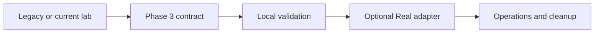

---
tags:
- observability
- opentelemetry
- python
- free
lab:
  id: '033'
  level: L300
  journey: microsoft-foundry
  time_min: 45
  cost:
    tier: free
    requires: []
    estimate_usd: 0 within the documented free path or quota.
    simulation: false
    cleanup: false
  status: active
  last_verified: '2026-10-27'
  languages:
  - en
  - pt
  - fr
---
!!! warning "Mise à jour du backend (octobre 2026)"
    L'inférence GitHub Models a été retirée le 30 juillet 2026. Les références ci-dessous sont conservées uniquement comme contexte historique pendant la migration de ce lab. Utilisez le [Lab 013 — Backends LLM gratuits](../labs/lab-013-github-models.md) pour configurer Foundry Local ou Ollama avant de continuer.

# Lab 033 : Observabilité des agents avec Application Insights

<div class="lab-meta">
  <span><strong>Niveau :</strong> <span class="level-badge level-300">L300</span></span>
  <span><strong>Parcours :</strong> <a href="../paths/foundry/">Microsoft Foundry</a></span>
  <span><strong>Durée :</strong> ~45 min</span>
  <span><strong>💰 Coût :</strong> <span class="level-badge cost-free">Gratuit (local)</span> + Azure Application Insights optionnel (niveau gratuit)</span>
</div>

## Ce que vous apprendrez

- Ajouter le **traçage OpenTelemetry** à un agent IA Python
- Capturer les **spans LLM** — prompts, complétions, nombre de tokens, latence
- Exporter les traces vers la console (gratuit) ou Azure Application Insights
- Construire un **tableau de bord personnalisé** de métriques d'agent
- Détecter les requêtes lentes et les interactions coûteuses

---

## Introduction

Les agents en production échouent silencieusement. Sans observabilité :

- Vous ne savez pas pourquoi un agent a donné une mauvaise réponse
- Vous ne pouvez pas mesurer la qualité des réponses au fil du temps
- Vous ne pouvez pas détecter quand les coûts en tokens explosent

**OpenTelemetry** est le standard ouvert pour le traçage distribué. Le package `opentelemetry-sdk` vous permet d'instrumenter les agents Python pour émettre des spans pour chaque appel LLM, exécution d'outil et étape de récupération.

---

## Prérequis

- Python 3.11+
- `pip install opentelemetry-sdk opentelemetry-exporter-otlp openai`
- `GITHUB_TOKEN` défini
- Optionnel : abonnement Azure pour Application Insights

---

## Exercice du lab

### Étape 1 : Installer les dépendances

```bash
pip install \
  opentelemetry-sdk \
  opentelemetry-exporter-otlp-proto-grpc \
  opentelemetry-instrumentation-requests \
  openai
```

### Étape 2 : Créer un agent tracé

```python
# traced_agent.py
import os, time, json
from openai import OpenAI
from opentelemetry import trace
from opentelemetry.sdk.trace import TracerProvider
from opentelemetry.sdk.trace.export import (
    ConsoleSpanExporter,
    SimpleSpanProcessor,
    BatchSpanProcessor,
)
from opentelemetry.sdk.resources import Resource

# --- Setup OpenTelemetry ---
resource = Resource.create({"service.name": "outdoorgear-agent", "service.version": "1.0.0"})
provider = TracerProvider(resource=resource)

# Export to console (free, always works)
provider.add_span_processor(SimpleSpanProcessor(ConsoleSpanExporter()))

trace.set_tracer_provider(provider)
tracer = trace.get_tracer("outdoorgear.agent")

# --- OpenAI client ---
client = OpenAI(
    base_url="https://models.inference.ai.azure.com",
    api_key=os.environ["GITHUB_TOKEN"],
)

PRODUCTS = [
    {"name": "TrailBlazer X200", "price": 189.99, "category": "footwear"},
    {"name": "Summit Pro Tent",   "price": 349.00, "category": "camping"},
    {"name": "OmniPack 45L",     "price": 279.99, "category": "packs"},
]

def search_products(query: str) -> list[dict]:
    """Tool: search products (simulates DB query)."""
    q = query.lower()
    return [p for p in PRODUCTS if q in p["name"].lower() or q in p["category"].lower()]


def run_agent(user_message: str) -> str:
    """Run the agent with full OpenTelemetry tracing."""
    with tracer.start_as_current_span("agent.run") as agent_span:
        agent_span.set_attribute("user.message", user_message)
        agent_span.set_attribute("agent.name", "outdoorgear-assistant")

        tools = [
            {
                "type": "function",
                "function": {
                    "name": "search_products",
                    "description": "Search products by keyword",
                    "parameters": {
                        "type": "object",
                        "properties": {
                            "query": {"type": "string", "description": "Search keyword"}
                        },
                        "required": ["query"]
                    }
                }
            }
        ]

        messages = [
            {"role": "system", "content": "You are a helpful outdoor gear assistant. Use search_products to find items."},
            {"role": "user",   "content": user_message}
        ]

        # --- LLM call span ---
        with tracer.start_as_current_span("llm.chat_completion") as llm_span:
            llm_span.set_attribute("llm.model", "gpt-4o-mini")
            llm_span.set_attribute("llm.prompt_messages", len(messages))

            start = time.perf_counter()
            response = client.chat.completions.create(
                model="gpt-4o-mini",
                messages=messages,
                tools=tools,
                tool_choice="auto",
            )
            latency_ms = (time.perf_counter() - start) * 1000

            usage = response.usage
            llm_span.set_attribute("llm.latency_ms", round(latency_ms, 2))
            llm_span.set_attribute("llm.prompt_tokens", usage.prompt_tokens)
            llm_span.set_attribute("llm.completion_tokens", usage.completion_tokens)
            llm_span.set_attribute("llm.total_tokens", usage.total_tokens)
            llm_span.set_attribute("llm.finish_reason", response.choices[0].finish_reason)

        # --- Tool call span (if needed) ---
        tool_calls = response.choices[0].message.tool_calls
        if tool_calls:
            messages.append(response.choices[0].message)

            for tc in tool_calls:
                with tracer.start_as_current_span("tool.search_products") as tool_span:
                    args = json.loads(tc.function.arguments)
                    tool_span.set_attribute("tool.name", tc.function.name)
                    tool_span.set_attribute("tool.query", args.get("query", ""))

                    t_start = time.perf_counter()
                    results = search_products(args["query"])
                    tool_span.set_attribute("tool.latency_ms", round((time.perf_counter() - t_start) * 1000, 2))
                    tool_span.set_attribute("tool.results_count", len(results))

                    messages.append({
                        "role": "tool",
                        "tool_call_id": tc.id,
                        "content": json.dumps(results)
                    })

            # --- Final LLM call ---
            with tracer.start_as_current_span("llm.chat_completion_final") as final_span:
                start = time.perf_counter()
                final = client.chat.completions.create(model="gpt-4o-mini", messages=messages)
                final_span.set_attribute("llm.latency_ms", round((time.perf_counter() - start) * 1000, 2))
                final_span.set_attribute("llm.total_tokens", final.usage.total_tokens)
                answer = final.choices[0].message.content
        else:
            answer = response.choices[0].message.content

        agent_span.set_attribute("agent.response_length", len(answer))
        return answer


# Test
questions = [
    "What hiking boots do you have?",
    "Show me camping gear",
    "What's the weather like today?",  # Off-topic — tests graceful handling
]

for q in questions:
    print(f"\n> {q}")
    answer = run_agent(q)
    print(f"  {answer}")
```

```bash
python traced_agent.py
```

Vous verrez des spans JSON structurés dans la sortie console montrant chaque appel LLM, le nombre de tokens et la latence.

### Étape 3 : Ajouter une journalisation structurée des métriques

```python
# metrics_logger.py
import json, datetime
from pathlib import Path

METRICS_FILE = Path("agent_metrics.jsonl")

def log_metrics(user_message: str, response: str, prompt_tokens: int,
                completion_tokens: int, latency_ms: float, tool_calls: int = 0):
    """Append a metrics record to a JSONL file for analysis."""
    record = {
        "timestamp": datetime.datetime.utcnow().isoformat(),
        "user_message": user_message[:100],
        "response_length": len(response),
        "prompt_tokens": prompt_tokens,
        "completion_tokens": completion_tokens,
        "total_tokens": prompt_tokens + completion_tokens,
        "latency_ms": round(latency_ms, 2),
        "tool_calls": tool_calls,
        "estimated_cost_usd": round((prompt_tokens * 0.00000015) + (completion_tokens * 0.0000006), 6),
    }
    with open(METRICS_FILE, "a") as f:
        f.write(json.dumps(record) + "\n")
    return record
```

### Étape 4 : Analyser les métriques

```python
# analyze_metrics.py
import json
from pathlib import Path
from collections import defaultdict

records = [json.loads(line) for line in Path("agent_metrics.jsonl").read_text().splitlines() if line]

if not records:
    print("No metrics yet. Run traced_agent.py first.")
else:
    total_tokens = sum(r["total_tokens"] for r in records)
    avg_latency  = sum(r["latency_ms"] for r in records) / len(records)
    total_cost   = sum(r["estimated_cost_usd"] for r in records)
    tool_calls   = sum(r["tool_calls"] for r in records)

    print(f"=== Agent Metrics Report ===")
    print(f"Total requests:    {len(records)}")
    print(f"Total tokens used: {total_tokens:,}")
    print(f"Avg latency:       {avg_latency:.0f}ms")
    print(f"Total tool calls:  {tool_calls}")
    print(f"Estimated cost:    ${total_cost:.4f}")
    print()

    # Slowest requests
    slowest = sorted(records, key=lambda r: r["latency_ms"], reverse=True)[:3]
    print("=== Slowest Requests ===")
    for r in slowest:
        print(f"  {r['latency_ms']}ms — '{r['user_message']}'")
```

### Étape 5 : (Optionnel) Exporter vers Azure Application Insights

Si vous avez un abonnement Azure, vous pouvez exporter les traces vers Application Insights pour la supervision en production :

```bash
pip install azure-monitor-opentelemetry
```

```python
# Replace the console exporter with Azure Monitor:
from azure.monitor.opentelemetry import configure_azure_monitor

configure_azure_monitor(
    connection_string=os.environ["APPLICATIONINSIGHTS_CONNECTION_STRING"]
)
# No other code changes needed — OTel handles the rest
```

Obtenez la chaîne de connexion depuis :
> Portail Azure → Ressource Application Insights → Vue d'ensemble → Chaîne de connexion

---

## Ce que chaque span capture

| Span | Attributs clés |
|------|----------------|
| `agent.run` | user.message, agent.name |
| `llm.chat_completion` | model, latency_ms, prompt_tokens, completion_tokens |
| `tool.search_products` | tool.name, query, results_count, latency_ms |
| `llm.chat_completion_final` | latency_ms, total_tokens |

---

## Prochaines étapes

- **Orchestration multi-agents :** → [Lab 034 — SK Multi-Agent](lab-034-multi-agent-sk.md)
- **Évaluation des agents :** → [Lab 035 — Evaluation SDK](lab-035-agent-evaluation.md)

<!-- phase3-modernization:start -->
## Modernisation de Phase 3

!!! warning "Verified 2026-10-27"
    Émettez spans et attributs alignés OpenTelemetry GenAI et utilisez le Foundry Control Plane via les surfaces stables documentées. Marquez les conventions expérimentales.



- [OpenTelemetry generative AI conventions](https://opentelemetry.io/docs/specs/semconv/gen-ai/)
- [Foundry observability](https://learn.microsoft.com/azure/ai-foundry/concepts/trace-agent-concept)
<!-- phase3-modernization:end -->
