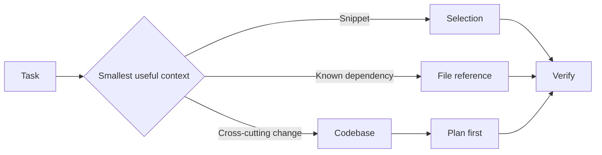

---
tags:
- github-copilot
- prompt-engineering
- context
lab:
  id: '085'
  level: L100
  journey: copilot
  time_min: 45
  cost:
    tier: free-gh
    requires: []
    estimate_usd: 0 within the documented free path or simulation.
    simulation: true
    cleanup: false
  roles:
  - developer
  - student
  technologies:
  - github-copilot
  - prompt-engineering
  - context
  status: active
  last_verified: '2026-10-27'
  languages:
  - en
  - pt
  - fr
---
# Lab 085: Ingénierie des prompts et du contexte dans GitHub Copilot

  <strong>Level:</strong> L100
  <strong>Parcours:</strong> copilot
  <strong>Durée:</strong> ~45 min
  <strong>Coût:</strong> GitHub Free

!!! info "Conception gratuite d'abord"
    Terminez l'exercice avec Copilot Free ou la simulation incluse. Les fonctions payantes sont facultatives et clairement indiquées.

!!! tip "Impact sur les AI Credits"
    Faible pour l'exercice guidé ; moyen/élevé pour les exécutions agentiques ou répétées. Préférez la sélection automatique du modèle, planifiez avant d'agir, gardez un contexte ciblé et évitez les sessions parallèles inutiles.

## Ce que vous apprendrez

- Choisir entre sélection, fichiers et contexte du dépôt
- Rédiger des prompts compacts avec contraintes et critères d'acceptation
- Utiliser Ask, Plan et Agent avec la bonne limite de contexte
- Réduire le gaspillage d'AI Credits grâce à un contexte intentionnel

## Alignement GH-300

**Responsible AI (15–20%) · Prompt and context (10–15%)**. Cette correspondance suit l'instantané GH-300 du **07/08/2026**. Le plan officiel peut conserver des termes anciens comme « Copilot Edits » ; ce lab enseigne l'expérience actuelle et signale la différence.

## Carte conceptuelle

## Exercice pratique

### Étape 1: Construire une échelle de contexte

Ouvrez un petit dépôt et résolvez la même question quatre fois : avec une sélection, un fichier référencé, un ensemble ciblé de fichiers et le contexte du dépôt. Notez quelles preuves changent la réponse.

### Étape 2: Rédiger un prompt d'implémentation

Utilisez la structure **objectif → contexte → contraintes → critères d'acceptation → validation**. Demandez au mode Plan d'identifier les fichiers concernés avant toute modification par le mode Agent.

### Étape 3: Effectuer le contrôle d'IA responsable

Vérifiez le code généré, citez les fichiers sources utilisés, examinez les hypothèses sensibles et refusez toute suggestion qui invente des API ou des secrets.

## Kit d'accompagnement

Le build du site génère des téléchargements PDF et ZIP stables. Le ZIP contient le guide du lab et tous les fichiers d'accompagnement déclarés.

- [Télécharger le PDF généré](../downloads/kits/lab-085-kit-fr.pdf)
- [Télécharger le ZIP généré](../downloads/kits/lab-085-kit-fr.zip)
