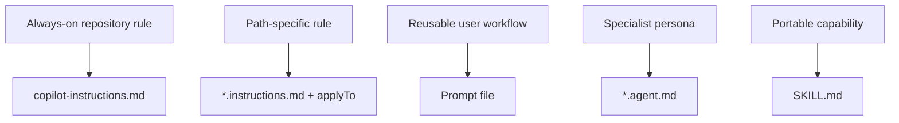

---
tags:
- github-copilot
- custom-instructions
- skills
- agents
lab:
  id: '086'
  level: L200
  journey: copilot
  time_min: 60
  cost:
    tier: free-gh
    requires: []
    estimate_usd: 0 within the documented free path or simulation.
    simulation: true
    cleanup: false
  roles:
  - developer
  - architect
  technologies:
  - github-copilot
  - custom-instructions
  - skills
  - agents
  status: active
  last_verified: '2026-10-27'
  languages:
  - en
  - pt
  - fr
---
# Lab 086: Personnaliser Copilot : instructions, fichiers de prompts, agents et skills

  <strong>Level:</strong> L200
  <strong>Parcours:</strong> copilot
  <strong>Durée:</strong> ~60 min
  <strong>Coût:</strong> GitHub Free

!!! info "Conception gratuite d'abord"
    Terminez l'exercice avec Copilot Free ou la simulation incluse. Les fonctions payantes sont facultatives et clairement indiquées.

!!! tip "Impact sur les AI Credits"
    Faible pour l'exercice guidé ; moyen/élevé pour les exécutions agentiques ou répétées. Préférez la sélection automatique du modèle, planifiez avant d'agir, gardez un contexte ciblé et évitez les sessions parallèles inutiles.

## Ce que vous apprendrez

- Choisir le bon artefact de personnalisation
- Limiter les instructions par chemin avec applyTo
- Créer des fichiers de prompts, agents et packages SKILL.md réutilisables
- Éviter les consignes dupliquées ou contradictoires

## Alignement GH-300

**Use Copilot features (25–30%)**. Cette correspondance suit l'instantané GH-300 du **07/08/2026**. Le plan officiel peut conserver des termes anciens comme « Copilot Edits » ; ce lab enseigne l'expérience actuelle et signale la différence.

## Carte conceptuelle

## Exercice pratique

### Étape 1: Créer les instructions du dépôt

Ajoutez `.github/copilot-instructions.md` avec les règles invariantes. Gardez-les courtes, testables et propres au dépôt.

### Étape 2: Ajouter des instructions ciblées

Créez `.github/instructions/python.instructions.md` avec le frontmatter `applyTo: "**/*.py"`. Placez ici les règles du langage.

### Étape 3: Conditionner le travail réutilisable

Utilisez un fichier de prompt pour un workflow déclenché, `*.agent.md` pour un spécialiste avec outils et `SKILL.md` pour une capacité portable avec exemples.

### Étape 4: Résoudre la priorité

Inspectez `AGENTS.md` et toutes les instructions applicables. Supprimez les doublons, explicitez les conflits et limitez les outils.

