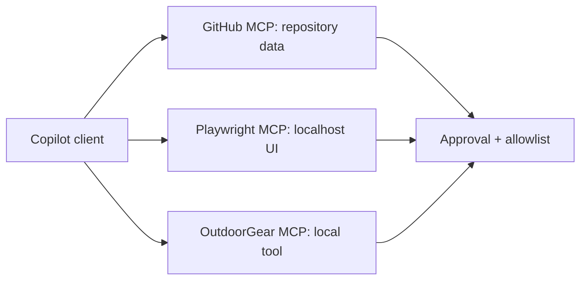

---
tags:
- github-copilot
- mcp
- playwright
- github-mcp-server
lab:
  id: '087'
  level: L200
  journey: copilot
  time_min: 60
  cost:
    tier: free-gh
    requires: []
    estimate_usd: 0 within the documented free path or simulation.
    simulation: true
    cleanup: false
  roles:
  - developer
  - architect
  technologies:
  - github-copilot
  - mcp
  - playwright
  - github-mcp-server
  status: active
  last_verified: '2026-10-27'
  languages:
  - en
  - pt
  - fr
---
# Lab 087: Copilot + MCP : GitHub, Playwright et votre propre serveur

  <strong>Level:</strong> L200
  <strong>Parcours:</strong> copilot
  <strong>Durée:</strong> ~60 min
  <strong>Coût:</strong> GitHub Free

!!! info "Conception gratuite d'abord"
    Terminez l'exercice avec Copilot Free ou la simulation incluse. Les fonctions payantes sont facultatives et clairement indiquées.

!!! tip "Impact sur les AI Credits"
    Faible pour l'exercice guidé ; moyen/élevé pour les exécutions agentiques ou répétées. Préférez la sélection automatique du modèle, planifiez avant d'agir, gardez un contexte ciblé et évitez les sessions parallèles inutiles.

## Ce que vous apprendrez

- Connecter des outils MCP approuvés à Copilot
- Comparer les serveurs GitHub, Playwright et local
- Appliquer listes d'autorisation et indications lecture seule
- Concevoir un contrat d'outil minimal

## Alignement GH-300

**Use Copilot features (25–30%) · Data and architecture (10–15%)**. Cette correspondance suit l'instantané GH-300 du **07/08/2026**. Le plan officiel peut conserver des termes anciens comme « Copilot Edits » ; ce lab enseigne l'expérience actuelle et signale la différence.

## Carte conceptuelle

## Exercice pratique

### Étape 1: Inventorier les serveurs

Listez serveur, transport, identifiants, frontière de données et outils avant connexion. Préférez le registre MCP GitHub ou un serveur inspectable.

### Étape 2: Exécuter une tâche GitHub en lecture seule

Demandez à Copilot de lister des issues ou métadonnées sans modifier l'état. Confirmez chaque appel avant d'élargir les droits.

### Étape 3: Tester Playwright en local

Utilisez Playwright MCP uniquement sur localhost. Relevez un point d'accessibilité et n'envoyez jamais de données privées à un serveur non vérifié.

### Étape 4: Réutiliser le Lab 020

Exposez un outil local OutdoorGear. Ajoutez schéma strict, sortie bornée, erreurs explicites et liste d'autorisation.

