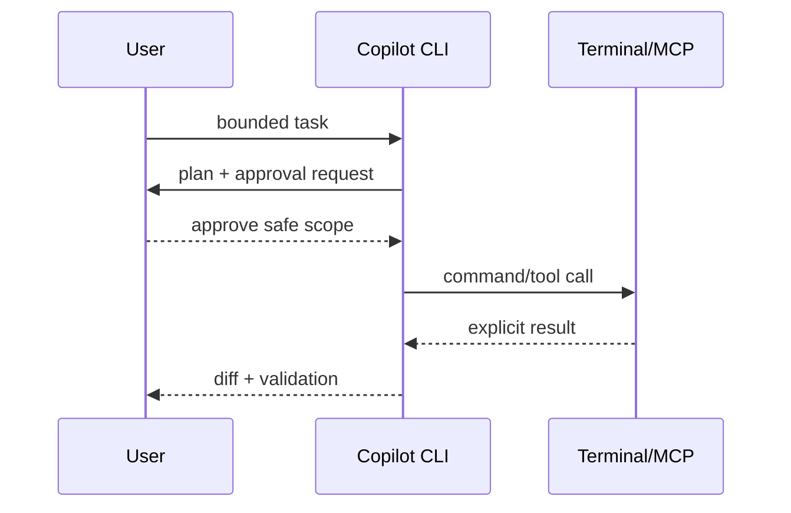

---
tags:
- github-copilot
- copilot-cli
- mcp
- hooks
lab:
  id: '088'
  level: L200
  journey: copilot
  time_min: 60
  cost:
    tier: free-gh
    requires: []
    estimate_usd: 0 within the documented free path or simulation.
    simulation: true
    cleanup: false
  roles:
  - developer
  - devops
  technologies:
  - github-copilot
  - copilot-cli
  - mcp
  - hooks
  status: active
  last_verified: '2026-10-27'
  languages:
  - en
  - pt
  - fr
---
# Lab 088: Copilot CLI : l'agent dans votre terminal

  <strong>Level:</strong> L200
  <strong>Parcours:</strong> copilot
  <strong>Durée:</strong> ~60 min
  <strong>Coût:</strong> GitHub Free

!!! info "Conception gratuite d'abord"
    Terminez l'exercice avec Copilot Free ou la simulation incluse. Les fonctions payantes sont facultatives et clairement indiquées.

!!! tip "Impact sur les AI Credits"
    Faible pour l'exercice guidé ; moyen/élevé pour les exécutions agentiques ou répétées. Préférez la sélection automatique du modèle, planifiez avant d'agir, gardez un contexte ciblé et évitez les sessions parallèles inutiles.

## Ce que vous apprendrez

- Installer et authentifier le Copilot CLI actuel
- Utiliser les modes interactif et programmatique
- Configurer agents, hooks, MCP et approbations
- Appliquer les contrôles de sécurité et de politique

## Alignement GH-300

**Use Copilot features (25–30%)**. Cette correspondance suit l'instantané GH-300 du **07/08/2026**. Le plan officiel peut conserver des termes anciens comme « Copilot Edits » ; ce lab enseigne l'expérience actuelle et signale la différence.

## Carte conceptuelle

## Exercice pratique

### Étape 1: Installer le CLI actuel

Utilisez le package officiel (`npm install -g @github/copilot`), WinGet, Homebrew ou le binaire. L'ancienne extension `gh copilot` est retirée.

### Étape 2: Commencer en lecture seule

Demandez au CLI d'expliquer le dépôt et de proposer une validation. Examinez le plan et chaque permission.

### Étape 3: Ajouter une automatisation contrôlée

Créez un agent de qualité documentaire, un hook bloquant l'affichage de secrets et un outil MCP en lecture seule.

### Étape 4: Tester le mode programmatique

Produisez une sortie lisible par machine pour une tâche bornée. Échouez en cas d'écriture non approuvée ou commande destructive.

