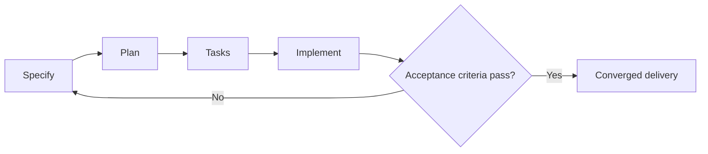

---
tags:
- github-copilot
- spec-kit
- spec-driven-development
lab:
  id: '089'
  level: L200
  journey: copilot
  time_min: 75
  cost:
    tier: free-gh
    requires: []
    estimate_usd: 0 within the documented free path or simulation.
    simulation: true
    cleanup: false
  roles:
  - developer
  - architect
  - student
  technologies:
  - github-copilot
  - spec-kit
  - spec-driven-development
  status: active
  last_verified: '2026-10-27'
  languages:
  - en
  - pt
  - fr
---
# Lab 089: Développement piloté par les spécifications avec Spec Kit

  <strong>Level:</strong> L200
  <strong>Parcours:</strong> copilot
  <strong>Durée:</strong> ~75 min
  <strong>Coût:</strong> GitHub Free

!!! info "Conception gratuite d'abord"
    Terminez l'exercice avec Copilot Free ou la simulation incluse. Les fonctions payantes sont facultatives et clairement indiquées.

!!! tip "Impact sur les AI Credits"
    Faible pour l'exercice guidé ; moyen/élevé pour les exécutions agentiques ou répétées. Préférez la sélection automatique du modèle, planifiez avant d'agir, gardez un contexte ciblé et évitez les sessions parallèles inutiles.

## Ce que vous apprendrez

- Transformer une idée en spécification testable
- Créer un plan et des tâches avec dépendances
- Implémenter avec Copilot en gardant la traçabilité
- Converger avec tests et preuves

## Alignement GH-300

**Productivity and tests (10–15%)**. Cette correspondance suit l'instantané GH-300 du **07/08/2026**. Le plan officiel peut conserver des termes anciens comme « Copilot Edits » ; ce lab enseigne l'expérience actuelle et signale la différence.

## Carte conceptuelle

## Exercice pratique

### Étape 1: Spécifier

Décrivez la fonctionnalité OutdoorGear par utilisateurs, comportement, contraintes, non-objectifs et critères mesurables.

### Étape 2: Planifier

Demandez à Spec Kit et Copilot de cartographier architecture, fichiers, risques et validation. Vérifiez le plan avant les modifications.

### Étape 3: Créer les tâches

Découpez en tâches vérifiables et notez les dépendances réelles. Chaque tâche doit correspondre à un critère.

### Étape 4: Implémenter et converger

Exécutez une tâche à la fois, lancez les tests minimaux, comparez avec la spécification et actualisez les artefacts.

## Kit d'accompagnement

Le build du site génère des téléchargements PDF et ZIP stables. Le ZIP contient le guide du lab et tous les fichiers d'accompagnement déclarés.

- [Télécharger le PDF généré](../downloads/kits/lab-089-kit-fr.pdf)
- [Télécharger le ZIP généré](../downloads/kits/lab-089-kit-fr.zip)
