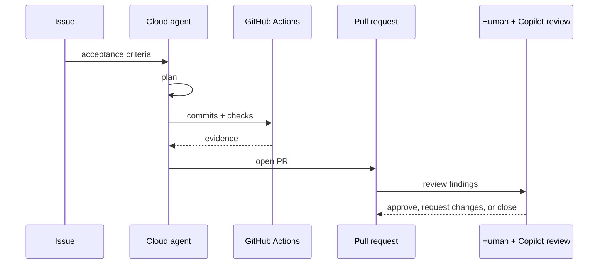

---
tags:
- github-copilot
- cloud-agent
- code-review
- github-actions
lab:
  id: '091'
  level: L300
  journey: copilot
  time_min: 90
  cost:
    tier: paid
    requires: []
    estimate_usd: 0 for simulation; variable for optional paid organization usage.
    simulation: true
    cleanup: true
  roles:
  - developer
  - tech-lead
  - admin
  technologies:
  - github-copilot
  - cloud-agent
  - code-review
  - github-actions
  status: active
  last_verified: '2026-10-27'
  languages:
  - en
  - pt
  - fr
---
# Lab 091: Agent cloud et revue de code Copilot : de l'issue à la PR

  <strong>Level:</strong> L300
  <strong>Parcours:</strong> copilot
  <strong>Durée:</strong> ~90 min
  <strong>Coût:</strong> Parcours payant facultatif ; simulation gratuite complète incluse

!!! info "Conception gratuite d'abord"
    Terminez l'exercice avec Copilot Free ou la simulation incluse. Les fonctions payantes sont facultatives et clairement indiquées.

!!! tip "Impact sur les AI Credits"
    Faible pour l'exercice guidé ; moyen/élevé pour les exécutions agentiques ou répétées. Préférez la sélection automatique du modèle, planifiez avant d'agir, gardez un contexte ciblé et évitez les sessions parallèles inutiles.

## Ce que vous apprendrez

- Tracer le cycle issue-vers-PR de l'agent cloud
- Vérifier pare-feu, permissions et instructions
- Évaluer les commentaires de revue Copilot
- Estimer AI Credits et minutes Actions

## Alignement GH-300

**Use Copilot features (25–30%) · Data and architecture (10–15%)**. Cette correspondance suit l'instantané GH-300 du **07/08/2026**. Le plan officiel peut conserver des termes anciens comme « Copilot Edits » ; ce lab enseigne l'expérience actuelle et signale la différence.

## Carte conceptuelle

## Exercice pratique

### Étape 1: Simulation gratuite : qualifier l'issue

Transformez une issue vague en critères, identifiez les instructions et choisissez un environnement au moindre privilège.

### Étape 2: Simulation gratuite : inspecter la session

Examinez la chronologie synthétique : plan, commits, checks, demandes réseau, niveau d'AI Credits et constats. Décidez des validations humaines.

### Étape 3: Simulation gratuite : revoir la PR

Classez chaque commentaire Copilot : actionnable, incertain ou incorrect. La revue reste consultative et ne remplace pas l'approbation humaine par défaut.

### Étape 4: Parcours payant facultatif

Si l'organisation active l'agent cloud, assignez l'issue, surveillez la session, examinez la PR, demandez une revue et relevez crédits et minutes réels.

## Simulation Gratuite Complète

Utilisez ce journal synthétique ; aucune licence d'organisation n'est nécessaire.

| Heure | Événement | Preuve | Décision humaine |
|---|---|---|---|
| 09:00 | Issue assignée | Critères : tests et aucune nouvelle dépendance | Accepter le périmètre |
| 09:03 | Plan proposé | Modifie API, tests et documentation | Refuser une migration de base hors sujet |
| 09:08 | Demande réseau | Demande `pypi.org` pour un package inutile | Refuser ; utiliser la bibliothèque standard |
| 09:15 | Commit 1 | Endpoint ajouté ; deux tests passent | Continuer |
| 09:22 | Commit 2 | Validation ajoutée ; six tests passent | Examiner les cas limites |
| 09:28 | PR ouverte | Niveau AI Credits : moyen ; Actions : 7 minutes | Demander la revue |
| 09:30 | Revue Copilot | Un contrôle null actionnable, une note spéculative | Corriger le null ; documenter le report de l'autre |

Rédigez une revue contenant :

1. Les permissions minimales et la liste réseau.
2. Le périmètre refusé et sa justification.
3. Le commentaire à appliquer.
4. Le coût : **AI Credits moyens**, **7 minutes Actions** et la prochaine optimisation.

## Kit d'accompagnement

Le build du site génère des téléchargements PDF et ZIP stables. Le ZIP contient le guide du lab et tous les fichiers d'accompagnement déclarés.

- [Télécharger le PDF généré](../downloads/kits/lab-091-kit-fr.pdf)
- [Télécharger le ZIP généré](../downloads/kits/lab-091-kit-fr.zip)
