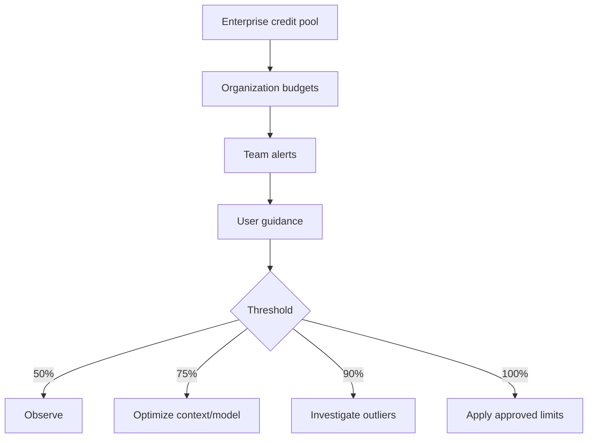

---
tags:
- github-copilot
- ai-controls
- ai-credits
- governance
- finops
lab:
  id: '094'
  level: L300
  journey: enterprise
  time_min: 90
  cost:
    tier: free-conditional
    requires: []
    estimate_usd: 0 within the documented free path or simulation.
    simulation: true
    cleanup: false
  roles:
  - admin
  - architect
  - finops
  - tech-lead
  technologies:
  - github-copilot
  - ai-controls
  - ai-credits
  - governance
  - finops
  status: active
  last_verified: '2026-10-27'
  languages:
  - en
  - pt
  - fr
---
# Lab 094: Gouvernance et FinOps Copilot : contrôles IA, politiques, budgets et crédits

  <strong>Level:</strong> L300
  <strong>Parcours:</strong> enterprise
  <strong>Durée:</strong> ~90 min
  <strong>Coût:</strong> Simulation gratuite ; parcours réel payant

!!! info "Conception gratuite d'abord"
    Terminez l'exercice avec Copilot Free ou la simulation incluse. Les fonctions payantes sont facultatives et clairement indiquées.

!!! tip "Impact sur les AI Credits"
    Faible pour l'exercice guidé ; moyen/élevé pour les exécutions agentiques ou répétées. Préférez la sélection automatique du modèle, planifiez avant d'agir, gardez un contexte ciblé et évitez les sessions parallèles inutiles.

## Ce que vous apprendrez

- Cartographier politiques Copilot et AI Controls
- Concevoir exclusion de contenu, audit et dépannage
- Estimer l'usage en AI Credits sans inventer de quotas
- Créer budgets en couches et playbooks de seuils

## Alignement GH-300

**Data and architecture (10–15%) · Privacy and safeguards (10–15%)**. Cette correspondance suit l'instantané GH-300 du **07/08/2026**. Le plan officiel peut conserver des termes anciens comme « Copilot Edits » ; ce lab enseigne l'expérience actuelle et signale la différence.

## Carte conceptuelle

## Exercice pratique

### Étape 1: Simulation gratuite : matrice de politiques

Pour chaque persona, décidez si complétions, chat, CLI, MCP, agent cloud, revue et agents tiers sont permis. Les agents VS Code locaux ne sont pas gouvernés de la même façon.

### Étape 2: Simulation gratuite : estimateur de crédits

Classez les charges faible, moyenne ou élevée. Estimez `tokens entrée × prix + tokens sortie × prix`, puis divisez les USD par 0,01 pour obtenir les crédits. Utilisez les prix officiels actuels.

### Étape 3: Concevoir des budgets en couches

Allouez pool entreprise, garde-fous organisation, alertes équipe et guidance utilisateur. Définissez les actions à 50 %, 75 %, 90 % et 100 %.

### Étape 4: Parcours payant facultatif

Dans une entreprise autorisée, reproduisez la matrice dans AI Controls, configurez audit et liste MCP, puis comparez usage réel et simulation.

## Simulation Gratuite Complète de Gouvernance

### Matrice de Politiques

| Persona | CLI | MCP | Agent cloud | Revue | Décision |
|---|---:|---:|---:|---:|---|
| Étudiant | Autoriser | Serveurs locaux approuvés | Simuler | Autoriser si activée | Apprentissage gratuit |
| Développeur | Autoriser | Liste du registre | Dépôts sélectionnés | Autoriser | Ingénierie standard |
| Prestataire | Conditionnel | Bloquer les serveurs inconnus | Bloquer | Lecture seule | Frontière de données restreinte |
| Admin plateforme | Autoriser | Gérer la liste | Organisations sélectionnées | Autoriser | Administration auditée |

### Estimateur d'AI Credits

Utilisez ce scénario transparent :

| Charge | Tokens entrée | Tokens sortie | Prix entrée / 1M | Prix sortie / 1M | USD estimé | AI Credits |
|---|---:|---:|---:|---:|---:|---:|
| Chat ciblé | 8 000 | 1 000 | 1,00 $ | 4,00 $ | 0,012 $ | 1,2 |
| Plan de dépôt | 60 000 | 4 000 | 1,00 $ | 4,00 $ | 0,076 $ | 7,6 |
| Session agent | 250 000 | 20 000 | 1,00 $ | 4,00 $ | 0,330 $ | 33,0 |

Formule : `USD = tokens_entrée / 1 000 000 × prix_entrée + tokens_sortie / 1 000 000 × prix_sortie` ; `AI Credits = USD / 0,01`.

Ces prix sont des entrées illustratives, pas une promesse de tarifs actuels. Remplacez-les par la table officielle avant toute décision réelle.
