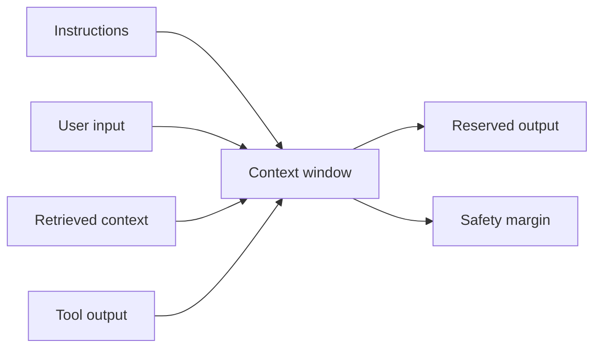

---
tags:
- tokens
- sampling
- context-window
- llm
lab:
  id: '097'
  level: L50
  journey: llm-foundations
  time_min: 30
  cost:
    tier: free
    requires: []
    estimate_usd: 0 within the documented free path or simulation.
    simulation: true
    cleanup: false
  roles:
  - student
  - developer
  - architect
  technologies:
  - tokens
  - sampling
  - context-window
  - llm
  status: active
  last_verified: '2026-10-27'
  languages:
  - en
  - pt
  - fr
---
# Lab 097: Interactif : tokens, échantillonnage et fenêtres de contexte

  <strong>Level:</strong> L50
  <strong>Parcours:</strong> llm-foundations
  <strong>Durée:</strong> ~30 min
  <strong>Coût:</strong> Gratuit

!!! info "Conception gratuite d'abord"
    Terminez l'exercice avec Copilot Free ou la simulation incluse. Les fonctions payantes sont facultatives et clairement indiquées.

!!! tip "Impact sur les AI Credits"
    Faible pour l'exercice guidé ; moyen/élevé pour les exécutions agentiques ou répétées. Préférez la sélection automatique du modèle, planifiez avant d'agir, gardez un contexte ciblé et évitez les sessions parallèles inutiles.

## Ce que vous apprendrez

- Estimer les tokens d'un texte
- Expliquer température, top-k et top-p
- Budgéter une fenêtre de contexte
- Reconnaître troncature et dilution du contexte

## Alignement GH-300

**Prompt and context foundations**. Cette correspondance suit l'instantané GH-300 du **07/08/2026**. Le plan officiel peut conserver des termes anciens comme « Copilot Edits » ; ce lab enseigne l'expérience actuelle et signale la différence.

## Carte conceptuelle

## Exercice pratique

### Étape 1: Estimer les tokens

Utilisez le widget ci-dessous. L'estimation est transparente mais n'est pas un tokenizer propre à un modèle. Comparez prose, code, JSON et accents.

### Étape 2: Explorer l'échantillonnage

Déplacez température, top-k et top-p. Prévoyez si la sortie devient déterministe ou diverse, puis révélez l'explication.

### Étape 3: Budgéter la fenêtre

Allouez instructions, entrée, contexte récupéré, outils et réponse. Gardez une marge et retirez d'abord le contexte à faible valeur.

## Kit d'accompagnement

Le build du site génère des téléchargements PDF et ZIP stables. Le ZIP contient le guide du lab et tous les fichiers d'accompagnement déclarés.

- [Télécharger le PDF généré](../downloads/kits/lab-097-kit-fr.pdf)
- [Télécharger le ZIP généré](../downloads/kits/lab-097-kit-fr.zip)
