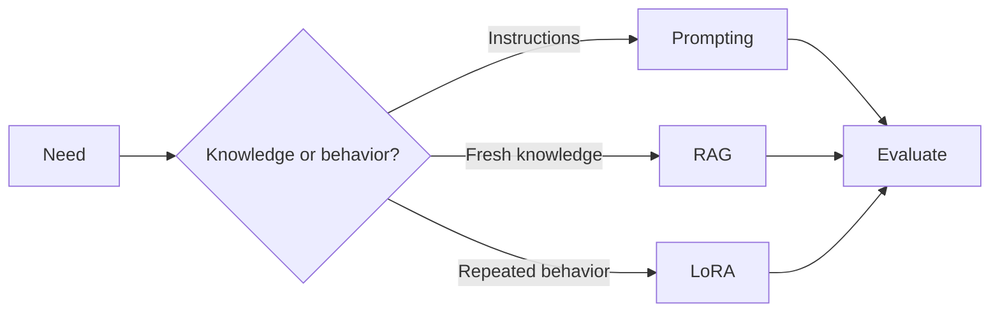

---
tags:
- kit
- local-first
- lora
- phase-3
- quiz
lab:
  id: '102'
  level: L300
  journey: llm-foundations
  time_min: 120
  cost:
    tier: free-conditional
    requires:
    - local-compute-or-optional-paid-service
    estimate_usd: 0 for the local simulation; optional Real usage varies by service
      and must be capped.
    simulation: true
    cleanup: false
  roles:
  - developer
  - architect
  - student
  technologies:
  - lora
  - phase-3
  status: active
  last_verified: '2026-10-27'
  languages:
  - en
  - pt
  - fr
---
# Lab 102: Fine-tuning vs RAG vs prompting + LoRA sur un petit modèle

<div class="lab-meta">
  <span><strong>Level:</strong> <span class="level-badge level-300">L300</span></span>
  <span><strong>Parcours:</strong> llm-foundations</span>
  <span><strong>Durée:</strong> ~120 min</span>
  <span><strong>Coût:</strong> free-conditional</span>
</div>

!!! info "Phase 3 · local first"
    Le parcours obligatoire est déterministe et local. Le parcours Réel est facultatif, estimé et nettoyé.

## Ce que vous apprendrez

- Choisir prompting, RAG ou fine-tuning par les preuves
- Préparer un petit jeu LoRA
- Estimer coût GPU et Foundry avant entraînement
- Comparer qualité, fraîcheur, latence et exploitation

## Prérequis

- Python 3.10+ et un terminal
- Aucun identifiant pour le parcours obligatoire
- Lisez la spécification officielle avant un adaptateur hébergé

## Modèle visuel



## Scénario

OutdoorGear a besoin d'une implémentation révisable pour atelier, avec fixtures déterministes, frontières de confiance explicites, critères mesurables et adaptateur hébergé facultatif et réversible.

## Exercice guidé

### Step 1: `score_options`

1. Exécutez la fixture déterministe de cette étape.
2. Notez entrée, sortie, décision de politique et comportement d'échec.
3. Modifiez un comportement borné et relancez le test local.

**Evidence:** Conservez la commande, le résultat et une phrase expliquant pourquoi la preuve est fiable.

### Step 2: `prepare_dataset`

1. Exécutez la fixture déterministe de cette étape.
2. Notez entrée, sortie, décision de politique et comportement d'échec.
3. Modifiez un comportement borné et relancez le test local.

**Evidence:** Conservez la commande, le résultat et une phrase expliquant pourquoi la preuve est fiable.

### Step 3: `simulate_lora`

1. Exécutez la fixture déterministe de cette étape.
2. Notez entrée, sortie, décision de politique et comportement d'échec.
3. Modifiez un comportement borné et relancez le test local.

**Evidence:** Conservez la commande, le résultat et une phrase expliquant pourquoi la preuve est fiable.

### Step 4: `compare_results`

1. Exécutez la fixture déterministe de cette étape.
2. Notez entrée, sortie, décision de politique et comportement d'échec.
3. Modifiez un comportement borné et relancez le test local.

**Evidence:** Conservez la commande, le résultat et une phrase expliquant pourquoi la preuve est fiable.

### Exécuter localement

```bash
cd docs/docs/fr/labs/lab-102
python -m unittest discover -v
```

## Simulation / Parcours Réel

<div class="phase3-path-tabs" data-phase3-tabs>
  <div role="tablist" aria-label="Simulation / Parcours Réel">
    <button type="button" role="tab" aria-selected="true" data-phase3-tab="simulation">Simulation</button>
    <button type="button" role="tab" aria-selected="false" data-phase3-tab="real">Parcours Réel</button>
  </div>
  <section role="tabpanel" data-phase3-panel="simulation">
    Utilisez les fixtures déterministes et le validateur local. Coût estimé : **0 USD**.
  </section>
  <section role="tabpanel" data-phase3-panel="real" hidden>
    Remplacez uniquement la frontière de l'adaptateur. Fixez un plafond, gardez les mêmes tests et notez région, rétention, identité, télémétrie et prix. Supprimez déploiements, points de terminaison, index, traces et données de test après validation.
  </section>
</div>

## Kit d'accompagnement

Le build du site génère des téléchargements PDF et ZIP stables. La CI conserve aussi un miroir temporaire pendant 30 jours.

- [`README.md` ](lab-102/README.md): démarrage et preuves
- [`CHEATSHEET.md` ](lab-102/CHEATSHEET.md): guide de décision
- [`scenario.json` ](lab-102/scenario.json): contrat déterministe
- [`test_scenario.py` ](lab-102/test_scenario.py): tests locaux
- [Télécharger le PDF généré](../downloads/kits/lab-102-kit-fr.pdf)
- [Télécharger le ZIP généré](../downloads/kits/lab-102-kit-fr.zip)

## Quiz noté

??? question "Pourquoi garder un contrat local ?"

    ??? success "Réponse"
        Il fournit une base déterministe avant la variabilité et le coût hébergés.

??? question "Quand le parcours Réel est-il terminé ?"

    ??? success "Réponse"
        Après enregistrement des preuves de validation et de nettoyage.

??? question "Comment traiter la sortie des outils ?"

    ??? success "Réponse"
        Comme donnée non fiable avant validation de politique et de schéma.

## Critères de sortie

- [ ] Les tests locaux passent sans identifiants.
- [ ] Le diagramme a une explication textuelle et ne dépend pas de la couleur.
- [ ] Le quiz noté a été revu.
- [ ] Le parcours Réel a un plafond et un plan de nettoyage.
- [ ] Sources et stabilité ont été vérifiées.

## Sources publiques officielles

- [Hugging Face PEFT](https://huggingface.co/docs/peft/)
- [Microsoft Foundry fine-tuning](https://learn.microsoft.com/azure/ai-foundry/concepts/fine-tuning-overview)
