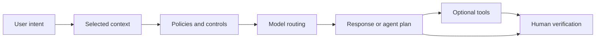

---
tags:
- github-copilot
- ai-credits
- models
- agents
lab:
  id: '107'
  level: L50
  journey: copilot
  time_min: 25
  cost:
    tier: free
    requires: []
    estimate_usd: 0 within the documented free path or simulation.
    simulation: true
    cleanup: false
  roles:
  - student
  - developer
  - admin
  - architect
  technologies:
  - github-copilot
  - ai-credits
  - models
  - agents
  status: active
  last_verified: '2026-10-27'
  languages:
  - en
  - pt
  - fr
---
# Lab 107: Comment fonctionne GitHub Copilot : contexte, modèles, agents et flux de données

  <strong>Level:</strong> L50
  <strong>Parcours:</strong> copilot
  <strong>Durée:</strong> ~25 min
  <strong>Coût:</strong> Gratuit

!!! info "Conception gratuite d'abord"
    Terminez l'exercice avec Copilot Free ou la simulation incluse. Les fonctions payantes sont facultatives et clairement indiquées.

!!! tip "Impact sur les AI Credits"
    Faible pour l'exercice guidé ; moyen/élevé pour les exécutions agentiques ou répétées. Préférez la sélection automatique du modèle, planifiez avant d'agir, gardez un contexte ciblé et évitez les sessions parallèles inutiles.

## Ce que vous apprendrez

- Décrire le cycle d'une requête Copilot
- Séparer sélection du contexte et du modèle
- Distinguer complétions, chat et agents
- Expliquer frontières de données, rétention et crédits IA

## Alignement GH-300

**GH-300 foundation · Data and architecture**. Cette correspondance suit l'instantané GH-300 du **07/08/2026**. Le plan officiel peut conserver des termes anciens comme « Copilot Edits » ; ce lab enseigne l'expérience actuelle et signale la différence.

## Carte conceptuelle

## Exercice pratique

### Étape 1: Tracer une requête

Suivez signaux de l'éditeur, références, instructions, politiques, routage du modèle, génération et vérification humaine.

### Étape 2: Comparer les expériences

Les complétions prédisent dans le flux d'édition ; le chat répond ; les agents planifient et utilisent des outils en plusieurs étapes.

### Étape 3: Cartographier données et facturation

Documentez contrôle du dépôt, contexte transmis, rétention, exclusions et interactions consommant des crédits IA.

## Kit d'accompagnement

Le build du site génère des téléchargements PDF et ZIP stables. Le ZIP contient le guide du lab et tous les fichiers d'accompagnement déclarés.

- [Télécharger le PDF généré](../downloads/kits/lab-107-kit-fr.pdf)
- [Télécharger le ZIP généré](../downloads/kits/lab-107-kit-fr.zip)
