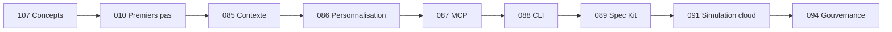

# 🤖 Parcours GitHub Copilot

L100 L200 L300 L400

Apprenez le flux Copilot actuel : complétions, Ask, Plan, Agent, chat en ligne, MCP, approbations sécurisées et instructions du dépôt.

## Labs Actuels

| Lab | Titre | Niveau | Coût |
|-----|-------|--------|------|
| [Lab 010](../../labs/lab-010-github-copilot-first-steps.md) | GitHub Copilot — Premiers Pas | L100 | GRÁTIS·GH |
| [Lab 016](../../labs/lab-016-copilot-agent-mode.md) | Copilot Agent et Plan | L100 | GRÁTIS·GH |
| [Lab 025](../../labs/lab-025-vscode-chat-participant.md) | VS Code Chat Participant | L200 | GRÁTIS·GH |
| [Lab 081](../../labs/lab-081-agentic-coding-tools.md) | Outils de Développement Agentique | L100 | GRÁTIS |
| [Lab 085](../../labs/lab-085-copilot-prompt-context-engineering.md) | Ingénierie des prompts et du contexte | L100 | GRATUIT · GH |
| [Lab 086](../../labs/lab-086-customize-copilot.md) | Instructions, prompts, agents et skills | L200 | GRATUIT · GH |
| [Lab 087](../../labs/lab-087-copilot-mcp.md) | Copilot + MCP | L200 | GRATUIT · GH |
| [Lab 088](../../labs/lab-088-copilot-cli.md) | Copilot CLI | L200 | GRATUIT · GH |
| [Lab 089](../../labs/lab-089-spec-kit.md) | Développement piloté par les spécifications | L200 | GRATUIT · GH |
| [Lab 091](../../labs/lab-091-cloud-agent-code-review.md) | Agent cloud et revue de code | L300 | Simulation GRATUITE / parcours réel PAYANT |
| [Lab 094](../../labs/lab-094-copilot-governance-finops.md) | Gouvernance et FinOps | L300 | Simulation GRATUITE |
| [Lab 107](../../labs/lab-107-how-copilot-works.md) | Comment fonctionne GitHub Copilot | L50 | GRATUIT |

## État de la Migration 2026

- Le Lab 041 est retiré car les Copilot Extensions basées sur les GitHub Apps ont été abandonnées. Utilisez MCP, l'API VS Code ou le futur lab Copilot SDK.
- Le Lab 045 est retiré car Copilot Workspace a été abandonné. Utilisez Plan et Agent ; la feuille de route ajoute un lab Spec Kit.
- Les Labs 085–094 couvrent désormais instructions, skills, MCP, CLI, Spec Kit, agent cloud, revue de code, gouvernance et FinOps.

## Séquence Recommandée pour 2026

→ [Suivez le parcours GH-300 de quatre semaines](../gh-300/index.md)

## Copilot Free

Ce parcours est conçu pour Copilot Free, sauf lorsqu'un lab est explicitement payant ou simulé. Le plan inclut un quota de complétions et une allocation limitée d'AI Credits ; la disponibilité exacte peut changer, donc les labs n'inscrivent pas de quotas de chat ou de modèles en dur.

→ [Activer GitHub Copilot Free](https://github.com/features/copilot)

## Ressources Externes

- [Documentation GitHub Copilot](https://docs.github.com/copilot)
- [Personnaliser Copilot](https://docs.github.com/copilot/customizing-copilot)
- [Model Context Protocol](https://modelcontextprotocol.io/)
