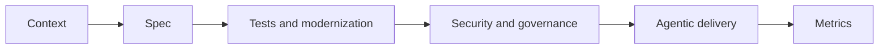

# Parcours GitHub Copilot — Phase 2

Passez de l'assistance individuelle à une livraison agentique testée, sûre, mesurable et révisable.

| Lab | Title | Level |
|---|---|---|
| [Lab 085](../../labs/lab-085-copilot-prompt-context-engineering.md) | Ingénierie des prompts et du contexte | L100 |
| [Lab 086](../../labs/lab-086-customize-copilot.md) | Personnaliser Copilot | L200 |
| [Lab 087](../../labs/lab-087-copilot-mcp.md) | Copilot + MCP | L200 |
| [Lab 088](../../labs/lab-088-copilot-cli.md) | Copilot CLI | L200 |
| [Lab 089](../../labs/lab-089-spec-kit.md) | Développement piloté par les spécifications | L200 |
| [Lab 090](../../labs/lab-090-copilot-testing-legacy-modernization.md) | Tests, refactorisation et modernisation du code existant avec Copilot | L200 |
| [Lab 091](../../labs/lab-091-cloud-agent-code-review.md) | Agent cloud et revue de code | L300 |
| [Lab 092](../../labs/lab-092-secure-code-copilot.md) | Code sécurisé avec Copilot : Autofix, secret scanning et risques des agents | L300 |
| [Lab 093](../../labs/lab-093-copilot-sdk-agent-app.md) | Copilot SDK : intégrer un agent dans votre application | L300 |
| [Lab 094](../../labs/lab-094-copilot-governance-finops.md) | Gouvernance Copilot et FinOps | L300 |
| [Lab 095](../../labs/lab-095-copilot-impact-metrics.md) | Mesurer l'impact de Copilot : API de métriques, DORA et SPACE | L300 |
| [Lab 096](../../labs/lab-096-agentic-devops-capstone.md) | Capstone — DevOps agentique : spec → plan → agent → revue → déploiement | L400 |

## Capstone sequence

Labs 089, 090, 092, 093, and 095 prepare the learner for Lab 096. Challenge 010 verifies the spec-to-PR workflow without GitHub Classroom.

## Public resources

- [GitHub Copilot documentation](https://docs.github.com/copilot)
- [VS Code Chat extension API](https://code.visualstudio.com/api/extension-guides/chat)
- [Model Context Protocol](https://modelcontextprotocol.io/)
