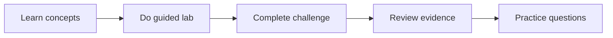

# Parcours de certification GH-300 GitHub Copilot

Cohorte équilibrée de quatre semaines pour apprenants et ateliers entreprise. Chaque semaine offre un parcours gratuit ; les activités d'organisation sont simulées sauf mention facultative et payante.

!!! warning "2026 terminology"
    Le plan officiel daté du 07/08/2026 peut encore citer « Copilot Edits ». Apprenez Ask, Plan et Agent actuels tout en reconnaissant le terme historique.

## Cohorte de Quatre Semaines

| Semaine | Travail requis | Accent GH-300 |
|---|---|---|
| Semaine 1 — Fondamentaux et IA responsable | Labs 107, 010, 085 et 008 | IA responsable (15–20 %) ; prompt et contexte (10–15 %) |
| Semaine 2 — Fonctions Copilot | Labs 016, 086, 087 et 088 | Utiliser les fonctions Copilot (25–30 %) |
| Semaine 3 — Productivité, tests et protections | Labs 089, 090 et 092 | Productivité et tests (10–15 %) ; confidentialité et protections (10–15 %) |
| Semaine 4 — Gouvernance et livraison | Labs 094, 091 (simulation) et examen blanc de 50 questions | Données et architecture (10–15 %) |

## Rythme de la Cohorte

Chaque atelier dure 90 minutes : 15 de concepts, 45 de pratique guidée, 15 de revue entre pairs et 15 de réflexion type examen. Un apprenant peut fractionner le travail.

## Parcours Gratuit et Entreprise

| Public | Parcours |
|---|---|
| Communauté / étudiant | Copilot Free, outils locaux, simulations et dépôts publics |
| Atelier entreprise | Même base gratuite, plus politiques facultatives, AI Controls, agent cloud et preuves d'usage |

## Pratique et Préparation à l'Examen

Utilisez la page Microsoft Learn, le sandbox et l'évaluation Skills Navigator. Les banques communautaires restent secondaires et non officielles.

- Expliquez pourquoi une réponse est correcte, pas seulement laquelle.
- Répétez confidentialité, exclusion, approbations et IA responsable.
- Suivez les domaines faibles et reprenez les labs avant la simulation finale.

## Examen Blanc de 50 Questions

Le simulateur couvre le parcours avec cinq personas. Seul le score final est stocké dans ce navigateur.

## Ressources Officielles

- [GH-300 certification](https://learn.microsoft.com/credentials/certifications/github-copilot/)
- [GitHub Copilot documentation](https://docs.github.com/copilot)
- [Copilot plans](https://docs.github.com/copilot/get-started/plans)
## Défis de la Phase 2

- [Challenge 010](../../challenges/challenge-010-spec-to-pr.md) valide le flux de la spécification à la pull request avec des tests locaux.
