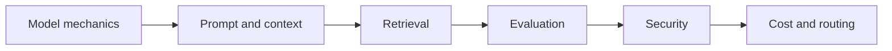

# Parcours Fondamentaux LLM 2.0

Construisez une base actuelle et locale pour comportement, récupération, évaluation, sécurité, contexte et coût.

| Lab | Title | Level | Time |
|---|---|---|---|
| [Lab 004](../../labs/lab-004-how-llms-work.md) | Fonctionnement des LLM : tokens, attention, entraînement et hallucination | L50 | 45 min |
| [Lab 005](../../labs/lab-005-prompt-engineering.md) | Prompting et ingénierie du contexte | L50 | 60 min |
| [Lab 007](../../labs/lab-007-what-are-embeddings.md) | Embeddings et recherche de similarité locale | L50 | 60 min |
| [Lab 017](../../labs/lab-017-structured-output.md) | Sorties structurées fiables avec validation locale | L100 | 60 min |
| [Lab 018](../../labs/lab-018-function-calling.md) | Appel d'outils avec contrats locaux typés | L100 | 60 min |
| [Lab 019](../../labs/lab-019-streaming-responses.md) | Réponses en streaming : événements, annulation et UX sûre | L100 | 50 min |
| [Lab 022](../../labs/lab-022-rag-github-models-pgvector.md) | RAG local : découpage → embedding → recherche → réponse | L200 | 90 min |
| [Lab 097](../../labs/lab-097-tokens-sampling-context.md) | Interactif : tokens, échantillonnage et fenêtres de contexte | L50 | 30 min |
| [Lab 098](../../labs/lab-098-context-engineering-agents.md) | Ingénierie du contexte pour les agents | L200 | 75 min |
| [Lab 099](../../labs/lab-099-llm-evaluations.md) | Évaluations LLM 101 : jeux de référence, LLM juge et régression CI | L200 | 90 min |
| [Lab 100](../../labs/lab-100-owasp-llm-agentic-threat-modeling.md) | OWASP Top 10 pour LLM et applications agentiques : modélisation des menaces | L200 | 75 min |
| [Lab 101](../../labs/lab-101-token-economics.md) | Économie des tokens : coût, cache, lot et routage | L200 | 60 min |

## Free-first route

All required exercises run locally with deterministic fixtures. Hosted embedding, generation, evaluation, and observability services are optional adapters.
