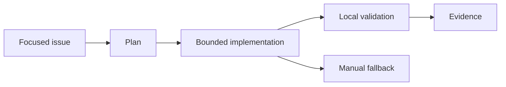

# Desafio 009: Passe Usando Só o Copilot Free

<div class="lab-meta">
  <span><strong>Level:</strong> <span class="level-badge level-200">L200</span></span>
  <span><strong>Type:</strong> Challenge</span>
  <span><strong>Time:</strong> ~60 min</span>
  <span><strong>Cost:</strong> <span class="level-badge cost-free">Free · GH</span></span>
</div>

## Scenario

Você não tem plano pago, assinatura de nuvem nem recursos de organização. Conclua uma tarefa real de repositório usando somente a franquia atual do Copilot Free e validação local.

## Objective

Crie um plano sem custo, sem dependências exclusivas de planos pagos e com comprovação por testes locais.



## Rules

- Use seleção automática de modelo.
- Use contexto focado e Plan antes de Agent.
- Não dependa de cloud agent, AI Controls enterprise ou seleção paga de modelos.
- Mantenha um fallback manual caso a franquia termine.

## Task

Preencha `copilot_free_plan.json`: escolha estratégia de contexto, quatro etapas, comandos locais de validação e fallback manual. Depois rode o validador.

| File | Purpose |
|---|---|
| `copilot_free_plan.json` | Starter plan |
| `test_copilot_free_plan.py` | Acceptance tests |
| `validate_copilot_free_plan.py` | Completion-code generator |

```bash
python -m unittest test_copilot_free_plan.py
python validate_copilot_free_plan.py
```

## Acceptance Criteria

- [ ] o plano é explicitamente grátis
- [ ] seleção automática está habilitada
- [ ] há pelo menos quatro etapas limitadas
- [ ] a validação é local
- [ ] existe fallback manual

<div class="challenge-validator" data-answer="CH009-FREE2026">
  <input type="text" aria-label="Completion code" placeholder="CH009-XXXXXXXX" />
  <button type="button">Validate</button>
  <p class="challenge-validator-result" aria-live="polite"></p>
</div>

## Related Labs

- [Lab 107](../labs/lab-107-how-copilot-works.md)
- [Lab 085](../labs/lab-085-copilot-prompt-context-engineering.md)
- [Lab 088](../labs/lab-088-copilot-cli.md)
