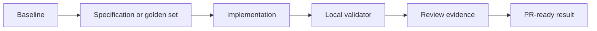

# Challenge 011: RAG Guiado por Avaliação

<div class="lab-meta">
  <span><strong>Nível:</strong> <span class="level-badge level-300">L300</span></span>
  <span><strong>Tipo:</strong> Desafio</span>
  <span><strong>Tempo:</strong> ~90 min</span>
  <span><strong>Custo:</strong> <span class="level-badge cost-free">Grátis</span></span>
</div>

## Cenário

Melhore um RAG local somente quando as métricas mostrarem ganho sem regressão de citações.



## Tarefa

1. Complete o JSON inicial sem alterar o esquema público.
2. Execute os testes e inspecione cada asserção com falha.
3. Mantenha a solução local e determinística.
4. Execute o validador para imprimir o código de conclusão.

## Critérios de aceitação

- [ ] Escopo, não objetivos, riscos e validação estão explícitos.
- [ ] Há pelo menos quatro passos de execução limitados.
- [ ] Os testes rodam sem credenciais ou GitHub Classroom.
- [ ] A evidência serve para a descrição de uma pull request.

## Validação local

```bash
cd docs/docs/pt/challenges/challenge-011
python -m unittest -v
python validate.py
```

<div class="challenge-validator" data-answer="CH011-EVALRAG">
  <input type="text" aria-label="Completion code" placeholder="CH011-XXXXXXXX" />
  <button type="button">Validate</button>
  <p class="challenge-validator-result" aria-live="polite"></p>
</div>

## Labs relacionados

- [Lab 090](../labs/lab-090-copilot-testing-legacy-modernization.md)
- [Lab 096](../labs/lab-096-agentic-devops-capstone.md)
- [Lab 099](../labs/lab-099-llm-evaluations.md)
- [Lab 022](../labs/lab-022-rag-github-models-pgvector.md)
