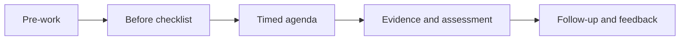

# Hub do Instrutor

Kits públicos e reproduzíveis para aprendizagem facilitada.

## Delivery formats

| Format | Public kit | Agenda |
|---|---|---|
| 2 hours | Labs 014 + 104 | 15 welcome · 25 concepts · 55 lab · 15 debrief · 10 assessment |
| 4 hours | Labs 014 + 023 + 106 | 20 welcome · 40 concepts · 140 labs · 25 breaks · 35 assessment |
| 4-week cohort | AI-103 route | Weekly pre-work, 90-minute workshop, office hour, evidence review |
| Hackathon | Challenge 012 + Lab 040/042 | Brief, attack/build, mentor checks, demos, rubric |

## Pre-work

- Confirm Python 3.10+, Git, editor, and repository access.
- Run one local test directory without credentials.
- Read the cost guide and accessibility expectations.
- Do not collect private code, personal data, or secrets.

## Antes da sessão

- [ ] Select labs and publish prerequisites.
- [ ] Generate kits with `python scripts/generate_kits.py --check`.
- [ ] Test projector zoom, keyboard navigation, captions, and text alternatives.
- [ ] Prepare a local fallback for every hosted demo.
- [ ] Define timing, breaks, support channel, and escalation owner.

## Timed agenda template

| Minute | Instructor | Learners | Evidence |
|---:|---|---|---|
| 0–10 | Outcomes and safety | Confirm setup | Readiness check |
| 10–30 | Explain model and diagram | Ask questions | Concept poll |
| 30–75 | Facilitate local exercise | Pair implementation | Passing tests |
| 75–100 | Compare Real path | Record cost/cleanup | Decision record |
| 100–115 | Run scored check | Submit answers | Score |
| 115–120 | Close | Commit next step | Exit ticket |

## Depois da sessão

- [ ] Publish only public slides, notes, and links.
- [ ] Remove temporary hosted resources and test data.
- [ ] Share answers after the assessment window.
- [ ] Record accessibility, timing, and content corrections.
- [ ] Triage feedback without storing unnecessary personal data.

## Pesquisa de feedback

Use a five-question anonymous survey: confidence before/after, most useful activity, blocker, pace, and one improvement. Report aggregates only.

## Instructor notes and slides

- [2-hour notes](two-hour.md)
- [4-hour notes](four-hour.md)
- [4-week cohort](four-week-cohort.md)
- [Hackathon](hackathon.md)
