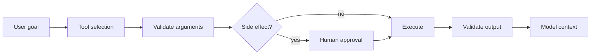

---
tags:
- tools
- function-calling
- security
- local
lab:
  id: 018
  level: L100
  journey: llm-foundations
  time_min: 60
  cost:
    tier: free
    requires: []
    estimate_usd: 0 within the documented free path or simulation.
    simulation: true
    cleanup: false
  roles:
  - developer
  - student
  - architect
  technologies:
  - tools
  - function-calling
  - security
  - local
  status: active
  last_verified: '2026-10-27'
  languages:
  - en
  - pt
  - fr
---
# Lab 018: Chamadas de Ferramentas com Contratos Locais Tipados

<div class="lab-meta">
  <span><strong>Nível:</strong> <span class="level-badge level-100">L100</span></span>
  <span><strong>Jornada:</strong> llm-foundations</span>
  <span><strong>Tempo:</strong> ~60 min</span>
  <span><strong>Custo:</strong> <span class="level-badge cost-free">Grátis</span></span>
</div>

!!! info "Desenho gratuito primeiro"
    O caminho obrigatório é local, simulado ou funciona com GitHub Copilot Free. Todo caminho organizacional, de nuvem ou pago está marcado como opcional.

!!! tip "Impacto em AI Credits"
    Mantenha a tarefa limitada, use o menor contexto útil e valide localmente. Execuções repetidas de agentes e modelos premium podem consumir mais AI Credits.

## O que você aprenderá

- Descrever ferramentas com nomes, argumentos e resultados restritos
- Validar argumentos antes da execução e resultados antes do reuso
- Exigir aprovação para efeitos colaterais e dados sensíveis
- Tratar descrições e saídas de ferramentas como entrada não confiável

## Pré-requisitos

- Python 3.10+ para o exercício local
- Um editor de texto e terminal
- Lab 087

## Resultado e evidência

O lab só termina quando o aluno mostra evidência, não apenas descreve o conceito.

| Capacidade | Evidência obrigatória |
|---|---|
| Descrever ferramentas com nomes, argumentos e resultados restritos | `evidence/step-1.txt` mais um check local aprovado |
| Validar argumentos antes da execução e resultados antes do reuso | `evidence/step-2.txt` mais um check local aprovado |
| Exigir aprovação para efeitos colaterais e dados sensíveis | `evidence/step-3.txt` mais um check local aprovado |
| Tratar descrições e saídas de ferramentas como entrada não confiável | `evidence/step-4.txt` mais um check local aprovado |

## Plano do lab

| Fase | Minutos | Atividade |
|---|---:|---|
| Preparar | 10 | Ler o cenário, inspecionar fixtures e registrar premissas |
| Linha de base | 15 | Executar o comportamento atual e salvar o resultado |
| Implementar | 25 | Concluir os quatro passos em mudanças pequenas |
| Validar | 15 | Executar testes, inspecionar falhas e coletar evidências |
| Revisar | 10+ | Explicar trade-offs e comparar o caminho real opcional |

## Modelo visual



## Cenário

A OutdoorGear precisa de uma solução explicável, testável e segura para workshops. O exercício obrigatório usa fixtures locais determinísticas, permitindo reprodução sem conta de nuvem. Depois, um serviço real pode substituir somente a fronteira do adaptador.

## Exercício guiado

### Step 1

**Objetivo:** Fazer uma melhoria observável preservando o contrato declarado.

**Ação:** Execute `tool_router.py` com pedidos seguros, inválidos e sujeitos a aprovação.

**Evidência:** Salve comando, resultado, arquivo alterado e uma frase explicando por que o resultado é confiável.

**Revisão:** Revise entradas, premissas, falhas, fronteira de segurança e o menor contexto útil.

### Step 2

**Objetivo:** Fazer uma melhoria observável preservando o contrato declarado.

**Ação:** Adicione enum e intervalo à ferramenta de estoque.

**Evidência:** Salve comando, resultado, arquivo alterado e uma frase explicando por que o resultado é confiável.

**Revisão:** Revise entradas, premissas, falhas, fronteira de segurança e o menor contexto útil.

### Step 3

**Objetivo:** Fazer uma melhoria observável preservando o contrato declarado.

**Ação:** Bloqueie instruções em resultados de ferramentas como instruções de sistema.

**Evidência:** Salve comando, resultado, arquivo alterado e uma frase explicando por que o resultado é confiável.

**Revisão:** Revise entradas, premissas, falhas, fronteira de segurança e o menor contexto útil.

### Step 4

**Objetivo:** Fazer uma melhoria observável preservando o contrato declarado.

**Ação:** Registre decisão, argumentos, aprovação, resultado e categoria de erro.

**Evidência:** Salve comando, resultado, arquivo alterado e uma frase explicando por que o resultado é confiável.

**Revisão:** Revise entradas, premissas, falhas, fronteira de segurança e o menor contexto útil.

### Execute localmente

```bash
cd docs/docs/pt/labs/lab-018
python -m unittest discover -v
```

Crie uma pasta `evidence/` fora do repositório para guardar saídas. Não faça commit de credenciais, código privado ou dados pessoais.

## Rubrica de revisão

| Categoria | Evidência de conclusão |
|---|---|
| Correção | Testes provam o comportamento e os limites importantes. |
| Evidência | Comandos, resultados e premissas são reproduzíveis. |
| Segurança | Entradas, permissões, segredos e efeitos colaterais estão controlados. |
| Manutenibilidade | A solução é limitada, legível e reversível. |

## Falhas comuns e recuperação

| Falha | Recuperação |
|---|---|
| O caminho feliz passa, mas os limites falham. | Adicione casos negativos, vazios, máximos e malformados. |
| O modelo propõe reescrita ampla. | Volte à menor mudança que preserva comportamento e repita a linha de base. |
| Ferramenta ou documento recuperado contém instruções. | Trate como dado não confiável e aplique política fora do modelo. |
| O resultado não é reproduzível. | Fixe fixtures, registre versões e remova credenciais ocultas ou serviços mutáveis. |

## Acessibilidade e uso responsável

- Não dependa apenas de cores em diagramas ou resultados.
- Mantenha comandos copiáveis e forneça equivalentes textuais para evidência visual.
- Não coloque segredos, dados pessoais ou código privado em prompts e fixtures.
- Exija revisão humana antes de ações irreversíveis, de alto impacto ou em produção.

## Kit de apoio

O kit para download contém o guia do lab, exercícios locais, uma folha de consulta e os diagramas citados. A CI publica artefatos PDF e ZIP determinísticos.

| Item | Finalidade |
|---|---|
| `README.md` | Início rápido e evidência esperada |
| Fixtures locais Python/JSON/CSV | Exercício prático reproduzível |
| `CHEATSHEET.md` | Conceitos, comandos e checklist de revisão |
| PDF gerado | Guia imprimível produzido na CI |
| ZIP gerado | Kit offline produzido na CI |

## Caminho real opcional

Substitua somente a fronteira do adaptador por um serviço hospedado aprovado. Preserve fixtures, critérios de aceitação, telemetria e testes de regressão para comparar caminhos local e real. Verifique preço, retenção, região e políticas da organização antes.

## Verificação de conhecimento

??? question "Onde está a fronteira de segurança?"

    ??? success "Resposta"
        Na validação e autorização antes da execução, não na intenção do modelo.

??? question "Que evidência deve ser salva?"

    ??? success "Resposta"
        Comando, resultado, arquivo alterado, premissas e uma explicação curta de confiança.

??? question "Quando usar o caminho real opcional?"

    ??? success "Resposta"
        Depois que o contrato local passar e preço, política, dados e limpeza forem compreendidos.

## Critérios de saída

- [ ] O exercício local passa sem credenciais.
- [ ] Evidências e premissas estão registradas.
- [ ] Recursos pagos ou organizacionais continuam opcionais.
- [ ] Segurança, acessibilidade e falhas foram revisadas.
- [ ] O kit gerado pode ser reproduzido a partir do código-fonte.

## Fontes públicas

- [Model Context Protocol security](https://modelcontextprotocol.io/specification/latest/basic/security_best_practices)
