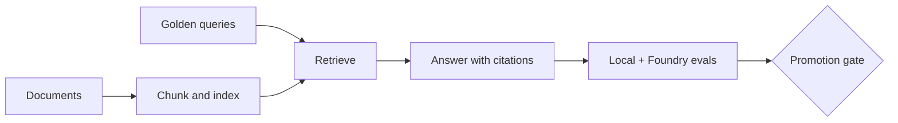

---
tags:
- foundry
- kit
- local-first
- phase-3
- quiz
lab:
  id: '042'
  level: L400
  journey: llm-foundations
  time_min: 180
  cost:
    tier: free-conditional
    requires:
    - local-compute-or-optional-paid-service
    estimate_usd: 0 for the local simulation; optional Real usage varies by service
      and must be capped.
    simulation: true
    cleanup: false
  roles:
  - developer
  - architect
  - student
  technologies:
  - foundry
  - phase-3
  status: active
  last_verified: '2026-10-27'
  languages:
  - en
  - pt
  - fr
---
# Lab 042: RAG Corporativo com Avaliações e Foundry

<div class="lab-meta">
  <span><strong>Level:</strong> <span class="level-badge level-400">L400</span></span>
  <span><strong>Jornada:</strong> llm-foundations</span>
  <span><strong>Tempo:</strong> ~180 min</span>
  <span><strong>Custo:</strong> free-conditional</span>
</div>

!!! info "Phase 3 · local first"
    O caminho obrigatório é determinístico e local. O caminho Real é opcional e inclui estimativa e limpeza.

## O que você aprenderá

- Construir linha de base RAG corporativa local
- Medir recuperação, fundamentação, citação, latência e custo
- Usar avaliação e tracing do Foundry como adaptador Real opcional
- Controlar promoção e limpar recursos pagos

## Pré-requisitos

- Python 3.10+ e um terminal
- Nenhuma credencial para o caminho obrigatório
- Leia a especificação oficial vinculada antes de usar um adaptador hospedado

## Modelo visual



## Cenário

A OutdoorGear precisa de uma implementação revisável para workshop, com fixtures determinísticas, fronteiras de confiança explícitas, critérios mensuráveis e adaptador hospedado opcional e reversível.

## Exercício guiado

### Step 1: `build_baseline`

1. Execute a fixture determinística desta etapa.
2. Registre entrada, saída, decisão de política e comportamento de falha.
3. Altere um comportamento limitado e execute o teste local novamente.

**Evidence:** Salve comando, resultado e uma frase explicando por que a evidência é confiável.

### Step 2: `evaluate_golden_set`

1. Execute a fixture determinística desta etapa.
2. Registre entrada, saída, decisão de política e comportamento de falha.
3. Altere um comportamento limitado e execute o teste local novamente.

**Evidence:** Salve comando, resultado e uma frase explicando por que a evidência é confiável.

### Step 3: `connect_foundry`

1. Execute a fixture determinística desta etapa.
2. Registre entrada, saída, decisão de política e comportamento de falha.
3. Altere um comportamento limitado e execute o teste local novamente.

**Evidence:** Salve comando, resultado e uma frase explicando por que a evidência é confiável.

### Step 4: `gate_and_cleanup`

1. Execute a fixture determinística desta etapa.
2. Registre entrada, saída, decisão de política e comportamento de falha.
3. Altere um comportamento limitado e execute o teste local novamente.

**Evidence:** Salve comando, resultado e uma frase explicando por que a evidência é confiável.

### Execute localmente

```bash
cd docs/docs/pt/labs/lab-042
python -m unittest discover -v
```

## Simulação / Caminho Real

<div class="phase3-path-tabs" data-phase3-tabs>
  <div role="tablist" aria-label="Simulação / Caminho Real">
    <button type="button" role="tab" aria-selected="true" data-phase3-tab="simulation">Simulação</button>
    <button type="button" role="tab" aria-selected="false" data-phase3-tab="real">Caminho Real</button>
  </div>
  <section role="tabpanel" data-phase3-panel="simulation">
    Use as fixtures determinísticas e o validador local incluídos. Custo estimado: **US$0**.
  </section>
  <section role="tabpanel" data-phase3-panel="real" hidden>
    Substitua somente a fronteira do adaptador. Defina teto de gastos, preserve os testes e registre região, retenção, identidade, telemetria e preço. Exclua implantações, endpoints, índices, traces e dados de teste após a validação.
  </section>
</div>

## Kit de apoio

- `README.md`: início rápido e checklist de evidências
- `CHEATSHEET.md`: guia de decisão e revisão
- `scenario.json`: contrato determinístico
- `test_scenario.py`: testes locais
- PDF e ZIP gerados pelo pipeline existente

## Quiz pontuado

??? question "Por que manter um contrato local?"

    ??? success "Resposta"
        Ele cria uma linha de base determinística antes de adicionar variabilidade e custo hospedados.

??? question "Quando o caminho Real termina?"

    ??? success "Resposta"
        Somente após registrar evidência de validação e limpeza.

??? question "Como tratar a saída de ferramentas?"

    ??? success "Resposta"
        Como dado não confiável até a validação de política e esquema.

## Critérios de saída

- [ ] Testes locais passam sem credenciais.
- [ ] O diagrama tem explicação textual e não depende de cor.
- [ ] O quiz pontuado foi revisado.
- [ ] O caminho Real tem teto de custo e plano de limpeza.
- [ ] Fontes e estabilidade foram verificadas.

## Fontes públicas oficiais

- [Foundry Agent Service GA announcement](https://devblogs.microsoft.com/foundry/foundry-agent-service-ga/)
- [Foundry Agent Service](https://learn.microsoft.com/azure/ai-foundry/agents/)
- [Foundry evaluation](https://learn.microsoft.com/azure/ai-foundry/concepts/evaluation-approach-gen-ai)
- [Foundry Workflows retirement](https://learn.microsoft.com/azure/foundry/agents/concepts/workflow)
