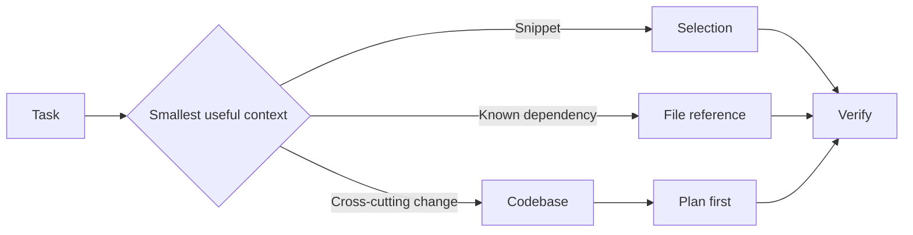

---
tags:
- github-copilot
- prompt-engineering
- context
lab:
  id: '085'
  level: L100
  journey: copilot
  time_min: 45
  cost:
    tier: free-gh
    requires: []
    estimate_usd: 0 within the documented free path or simulation.
    simulation: true
    cleanup: false
  roles:
  - developer
  - student
  technologies:
  - github-copilot
  - prompt-engineering
  - context
  status: active
  last_verified: '2026-10-27'
  languages:
  - en
  - pt
  - fr
---
# Lab 085: Engenharia de Prompt e de Contexto no GitHub Copilot

  <strong>Level:</strong> L100
  <strong>Jornada:</strong> copilot
  <strong>Tempo:</strong> ~45 min
  <strong>Custo:</strong> GitHub Free

!!! info "Desenho gratuito primeiro"
    Conclua o exercício com Copilot Free ou com a simulação incluída. Recursos pagos são opcionais e marcados claramente.

!!! tip "Impacto em AI Credits"
    Baixo no exercício guiado; médio/alto em execuções agênticas ou repetidas. Prefira seleção automática de modelo, planeje antes de agir, mantenha o contexto focado e evite sessões paralelas desnecessárias.

## O que Você Aprenderá

- Escolher entre seleção, arquivos e contexto da base de código
- Escrever prompts compactos com restrições e critérios de aceite
- Usar Ask, Plan e Agent com o limite de contexto correto
- Reduzir desperdício de AI Credits mantendo o contexto intencional

## Alinhamento GH-300

**Responsible AI (15–20%) · Prompt and context (10–15%)**. Este mapeamento segue o recorte curricular GH-300 de **07/08/2026**. O escopo oficial pode manter termos antigos como “Copilot Edits”; este lab ensina a experiência atual e sinaliza a diferença.

## Mapa Conceitual

## Exercício Prático

### Etapa 1: Monte uma escada de contexto

Abra um repositório pequeno e resolva a mesma pergunta quatro vezes: com uma seleção, um arquivo referenciado, um conjunto focado de arquivos e o contexto da base de código. Registre qual evidência mudou a resposta.

### Etapa 2: Escreva um prompt de implementação

Use a estrutura **objetivo → contexto → restrições → critérios de aceite → validação**. Peça ao modo Plan para identificar os arquivos afetados antes de o modo Agent editar qualquer coisa.

### Etapa 3: Execute a verificação de IA responsável

Verifique o código gerado, cite os arquivos-fonte usados, inspecione suposições sensíveis a segurança e rejeite sugestões que inventem APIs ou segredos.

