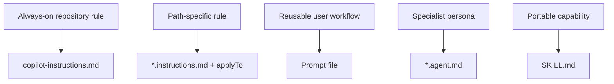

---
tags:
- github-copilot
- custom-instructions
- skills
- agents
lab:
  id: '086'
  level: L200
  journey: copilot
  time_min: 60
  cost:
    tier: free-gh
    requires: []
    estimate_usd: 0 within the documented free path or simulation.
    simulation: true
    cleanup: false
  roles:
  - developer
  - architect
  technologies:
  - github-copilot
  - custom-instructions
  - skills
  - agents
  status: active
  last_verified: '2026-10-27'
  languages:
  - en
  - pt
  - fr
---
# Lab 086: Personalize o Copilot: Instruções, Prompt Files, Agentes Customizados e Skills

  <strong>Level:</strong> L200
  <strong>Jornada:</strong> copilot
  <strong>Tempo:</strong> ~60 min
  <strong>Custo:</strong> GitHub Free

!!! info "Desenho gratuito primeiro"
    Conclua o exercício com Copilot Free ou com a simulação incluída. Recursos pagos são opcionais e marcados claramente.

!!! tip "Impacto em AI Credits"
    Baixo no exercício guiado; médio/alto em execuções agênticas ou repetidas. Prefira seleção automática de modelo, planeje antes de agir, mantenha o contexto focado e evite sessões paralelas desnecessárias.

## O que Você Aprenderá

- Escolher o artefato de customização correto
- Escopar instruções por caminho com applyTo
- Criar prompt files, agentes e pacotes SKILL.md reutilizáveis
- Evitar orientações duplicadas ou contraditórias

## Alinhamento GH-300

**Use Copilot features (25–30%)**. Este mapeamento segue o recorte curricular GH-300 de **07/08/2026**. O escopo oficial pode manter termos antigos como “Copilot Edits”; este lab ensina a experiência atual e sinaliza a diferença.

## Mapa Conceitual

## Exercício Prático

### Etapa 1: Crie instruções do repositório

Adicione `.github/copilot-instructions.md` com as regras invariantes de toda contribuição. Mantenha o texto curto, testável e específico do repositório.

### Etapa 2: Adicione instruções por escopo

Crie `.github/instructions/python.instructions.md` com o frontmatter `applyTo: "**/*.py"`. Coloque aqui regras da linguagem, não no arquivo global.

### Etapa 3: Empacote trabalho repetível

Use prompt file para um fluxo acionado pelo usuário, `*.agent.md` para uma persona especialista com ferramentas e `SKILL.md` para uma capacidade portátil com exemplos e recursos.

### Etapa 4: Resolva precedência

Inspecione `AGENTS.md` e todos os arquivos aplicáveis. Remova duplicações, explicite conflitos e mantenha permissões de ferramentas mínimas.

## Kit de apoio

O build do site gera downloads estáveis em PDF e ZIP. O ZIP contém o guia do lab e todos os arquivos de apoio declarados para este lab.

- [Baixar PDF gerado](../downloads/kits/lab-086-kit-pt.pdf)
- [Baixar ZIP gerado](../downloads/kits/lab-086-kit-pt.zip)
