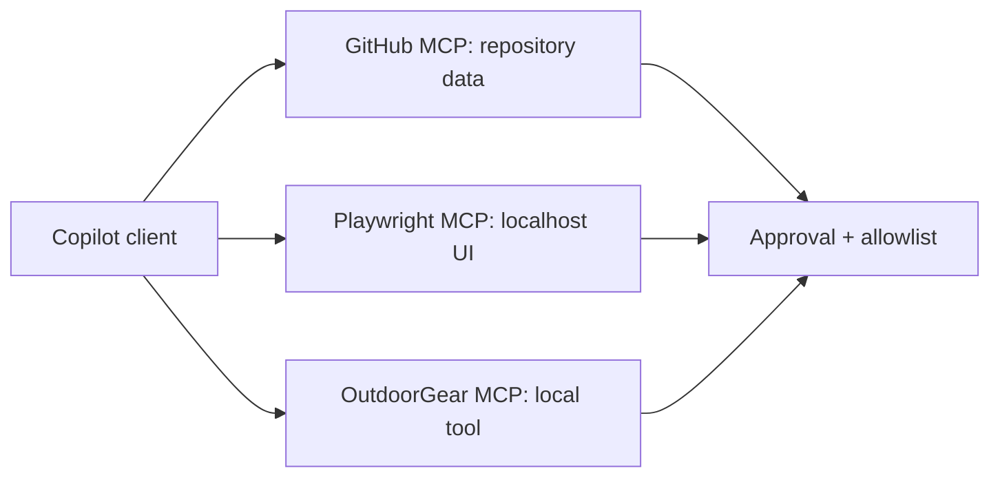

---
tags:
- github-copilot
- mcp
- playwright
- github-mcp-server
lab:
  id: '087'
  level: L200
  journey: copilot
  time_min: 60
  cost:
    tier: free-gh
    requires: []
    estimate_usd: 0 within the documented free path or simulation.
    simulation: true
    cleanup: false
  roles:
  - developer
  - architect
  technologies:
  - github-copilot
  - mcp
  - playwright
  - github-mcp-server
  status: active
  last_verified: '2026-10-27'
  languages:
  - en
  - pt
  - fr
---
# Lab 087: Copilot + MCP: GitHub MCP Server, Playwright e Seu Próprio Servidor

  <strong>Level:</strong> L200
  <strong>Jornada:</strong> copilot
  <strong>Tempo:</strong> ~60 min
  <strong>Custo:</strong> GitHub Free

!!! info "Desenho gratuito primeiro"
    Conclua o exercício com Copilot Free ou com a simulação incluída. Recursos pagos são opcionais e marcados claramente.

!!! tip "Impacto em AI Credits"
    Baixo no exercício guiado; médio/alto em execuções agênticas ou repetidas. Prefira seleção automática de modelo, planeje antes de agir, mantenha o contexto focado e evite sessões paralelas desnecessárias.

## O que Você Aprenderá

- Conectar ferramentas MCP aprovadas ao Copilot
- Comparar servidores GitHub, Playwright e local customizado
- Aplicar allowlists e indicações de somente leitura
- Projetar um contrato mínimo de ferramenta

## Alinhamento GH-300

**Use Copilot features (25–30%) · Data and architecture (10–15%)**. Este mapeamento segue o recorte curricular GH-300 de **07/08/2026**. O escopo oficial pode manter termos antigos como “Copilot Edits”; este lab ensina a experiência atual e sinaliza a diferença.

## Mapa Conceitual

## Exercício Prático

### Etapa 1: Inventarie os servidores

Liste servidor, transporte, credenciais, limite de dados e ferramentas antes de conectar. Prefira o GitHub MCP Registry ou um servidor cujo código você possa inspecionar.

### Etapa 2: Execute uma tarefa GitHub somente leitura

Peça ao Copilot para listar issues ou inspecionar metadados sem alterar estado. Confirme cada invocação antes de ampliar permissões.

### Etapa 3: Execute uma verificação Playwright local

Use Playwright MCP somente em localhost. Registre uma observação de acessibilidade e nunca envie dados privados a servidor não revisado.

### Etapa 4: Reutilize o Lab 020

Exponha uma ferramenta local de consulta OutdoorGear. Adicione schema estrito, saída limitada, erros explícitos e allowlist.

