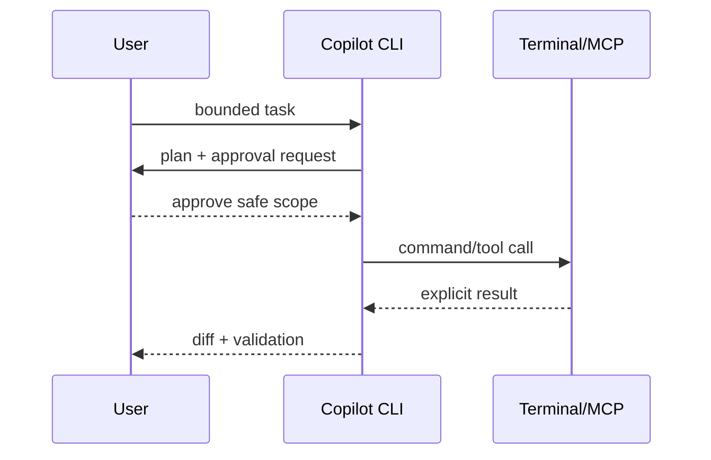

---
tags:
- github-copilot
- copilot-cli
- mcp
- hooks
lab:
  id: '088'
  level: L200
  journey: copilot
  time_min: 60
  cost:
    tier: free-gh
    requires: []
    estimate_usd: 0 within the documented free path or simulation.
    simulation: true
    cleanup: false
  roles:
  - developer
  - devops
  technologies:
  - github-copilot
  - copilot-cli
  - mcp
  - hooks
  status: active
  last_verified: '2026-10-27'
  languages:
  - en
  - pt
  - fr
---
# Lab 088: Copilot CLI: o Agente no Terminal

  <strong>Level:</strong> L200
  <strong>Jornada:</strong> copilot
  <strong>Tempo:</strong> ~60 min
  <strong>Custo:</strong> GitHub Free

!!! info "Desenho gratuito primeiro"
    Conclua o exercício com Copilot Free ou com a simulação incluída. Recursos pagos são opcionais e marcados claramente.

!!! tip "Impacto em AI Credits"
    Baixo no exercício guiado; médio/alto em execuções agênticas ou repetidas. Prefira seleção automática de modelo, planeje antes de agir, mantenha o contexto focado e evite sessões paralelas desnecessárias.

## O que Você Aprenderá

- Instalar e autenticar o Copilot CLI atual
- Usar fluxos interativos e programáticos
- Configurar agentes, hooks, MCP e aprovações
- Aplicar verificações de segurança e política

## Alinhamento GH-300

**Use Copilot features (25–30%)**. Este mapeamento segue o recorte curricular GH-300 de **07/08/2026**. O escopo oficial pode manter termos antigos como “Copilot Edits”; este lab ensina a experiência atual e sinaliza a diferença.

## Mapa Conceitual

## Exercício Prático

### Etapa 1: Instale o CLI atual

Use o pacote oficial (`npm install -g @github/copilot`), WinGet, Homebrew ou o binário. A extensão aposentada `gh copilot` não é este produto.

### Etapa 2: Comece com um prompt somente leitura

Peça ao CLI para explicar o repositório e propor um comando de validação. Inspecione o plano e cada permissão solicitada.

### Etapa 3: Adicione automação controlada

Crie um agente de qualidade documental, um hook que bloqueie comandos que imprimem segredos e uma ferramenta MCP somente leitura.

### Etapa 4: Exercite o modo programático

Produza saída legível por máquina para uma tarefa limitada. Falhe se houver escrita não aprovada ou comando destrutivo.

