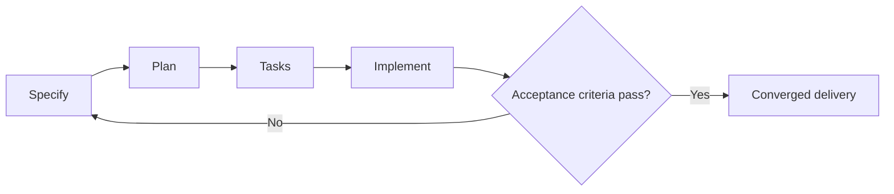

---
tags:
- github-copilot
- spec-kit
- spec-driven-development
lab:
  id: '089'
  level: L200
  journey: copilot
  time_min: 75
  cost:
    tier: free-gh
    requires: []
    estimate_usd: 0 within the documented free path or simulation.
    simulation: true
    cleanup: false
  roles:
  - developer
  - architect
  - student
  technologies:
  - github-copilot
  - spec-kit
  - spec-driven-development
  status: active
  last_verified: '2026-10-27'
  languages:
  - en
  - pt
  - fr
---
# Lab 089: Desenvolvimento Orientado a Especificação com Spec Kit

  <strong>Level:</strong> L200
  <strong>Jornada:</strong> copilot
  <strong>Tempo:</strong> ~75 min
  <strong>Custo:</strong> GitHub Free

!!! info "Desenho gratuito primeiro"
    Conclua o exercício com Copilot Free ou com a simulação incluída. Recursos pagos são opcionais e marcados claramente.

!!! tip "Impacto em AI Credits"
    Baixo no exercício guiado; médio/alto em execuções agênticas ou repetidas. Prefira seleção automática de modelo, planeje antes de agir, mantenha o contexto focado e evite sessões paralelas desnecessárias.

## O que Você Aprenderá

- Transformar uma ideia em especificação testável
- Criar plano e tarefas com dependências
- Implementar com Copilot mantendo rastreabilidade
- Convergir com testes e evidências

## Alinhamento GH-300

**Productivity and tests (10–15%)**. Este mapeamento segue o recorte curricular GH-300 de **07/08/2026**. O escopo oficial pode manter termos antigos como “Copilot Edits”; este lab ensina a experiência atual e sinaliza a diferença.

## Mapa Conceitual

## Exercício Prático

### Etapa 1: Especificar

Descreva a funcionalidade OutdoorGear por usuários, comportamento, restrições, não objetivos e critérios de aceite mensuráveis.

### Etapa 2: Planejar

Peça ao Spec Kit e ao Copilot para mapear arquitetura, arquivos, riscos e validação. Revise o plano antes de permitir edições.

### Etapa 3: Criar tarefas

Divida o trabalho em tarefas verificáveis e registre dependências reais. Cada tarefa deve apontar para um critério de aceite.

### Etapa 4: Implementar e convergir

Execute uma tarefa por vez, rode os menores testes relevantes, compare com a especificação e atualize os artefatos quando a realidade mudar.

## Kit de apoio

O build do site gera downloads estáveis em PDF e ZIP. O ZIP contém o guia do lab e todos os arquivos de apoio declarados para este lab.

- [Baixar PDF gerado](../downloads/kits/lab-089-kit-pt.pdf)
- [Baixar ZIP gerado](../downloads/kits/lab-089-kit-pt.zip)
