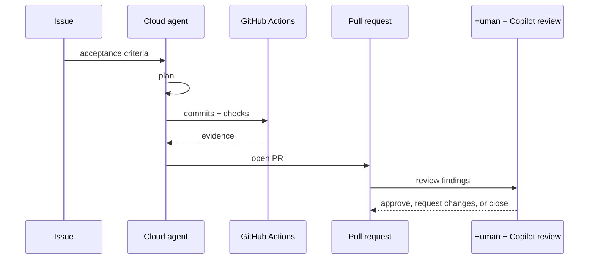

---
tags:
- github-copilot
- cloud-agent
- code-review
- github-actions
lab:
  id: '091'
  level: L300
  journey: copilot
  time_min: 90
  cost:
    tier: paid
    requires: []
    estimate_usd: 0 for simulation; variable for optional paid organization usage.
    simulation: true
    cleanup: true
  roles:
  - developer
  - tech-lead
  - admin
  technologies:
  - github-copilot
  - cloud-agent
  - code-review
  - github-actions
  status: active
  last_verified: '2026-10-27'
  languages:
  - en
  - pt
  - fr
---
# Lab 091: Cloud Agent e Code Review do Copilot: da Issue ao PR

  <strong>Level:</strong> L300
  <strong>Jornada:</strong> copilot
  <strong>Tempo:</strong> ~90 min
  <strong>Custo:</strong> Caminho pago opcional; simulação grátis completa incluída

!!! info "Desenho gratuito primeiro"
    Conclua o exercício com Copilot Free ou com a simulação incluída. Recursos pagos são opcionais e marcados claramente.

!!! tip "Impacto em AI Credits"
    Baixo no exercício guiado; médio/alto em execuções agênticas ou repetidas. Prefira seleção automática de modelo, planeje antes de agir, mantenha o contexto focado e evite sessões paralelas desnecessárias.

## O que Você Aprenderá

- Rastrear o ciclo issue-para-PR do cloud agent
- Revisar firewall, permissões e instruções do repositório
- Avaliar comentários do Copilot code review
- Estimar impacto em AI Credits e minutos de Actions

## Alinhamento GH-300

**Use Copilot features (25–30%) · Data and architecture (10–15%)**. Este mapeamento segue o recorte curricular GH-300 de **07/08/2026**. O escopo oficial pode manter termos antigos como “Copilot Edits”; este lab ensina a experiência atual e sinaliza a diferença.

## Mapa Conceitual

## Exercício Prático

### Etapa 1: Simulação grátis: faça a triagem

Use o cenário abaixo. Transforme uma issue vaga em critérios de aceite, identifique instruções e escolha um ambiente de privilégio mínimo.

### Etapa 2: Simulação grátis: inspecione a sessão

Revise a linha do tempo sintética: plano, commits, checks, solicitações de firewall, faixa de AI Credits e achados. Decida o que exige aprovação humana.

### Etapa 3: Simulação grátis: revise o PR

Classifique cada comentário do Copilot como acionável, incerto ou incorreto. O code review é consultivo e não substitui aprovação humana obrigatória por padrão.

### Etapa 4: Caminho pago opcional

Se a organização habilitar o cloud agent, atribua a issue, monitore a sessão, revise o PR, solicite code review e registre AI Credits e minutos de Actions reais.

## Simulação Grátis Completa

Use este registro sintético; nenhuma licença organizacional é necessária.

| Horário | Evento | Evidência | Decisão humana |
|---|---|---|---|
| 09:00 | Issue atribuída | Critérios exigem testes e nenhuma dependência nova | Aceitar escopo |
| 09:03 | Plano proposto | Altera API, testes e docs | Rejeitar migração de banco não relacionada |
| 09:08 | Solicitação de firewall | Pede `pypi.org` para pacote desnecessário | Negar; usar biblioteca padrão |
| 09:15 | Commit 1 | Implementa endpoint; dois testes passam | Continuar |
| 09:22 | Commit 2 | Adiciona validação; seis testes passam | Inspecionar casos extremos |
| 09:28 | PR aberto | Faixa de AI Credits: média; Actions: 7 minutos | Solicitar review |
| 09:30 | Code review | Um null check acionável e uma nota especulativa | Corrigir null check; justificar adiamento da outra |

Escreva uma revisão contendo:

1. Permissões mínimas e allowlist de rede.
2. Escopo rejeitado e justificativa.
3. Qual comentário aplicar.
4. Registro de custo: **AI Credits médios**, **7 minutos de Actions** e a próxima otimização.
