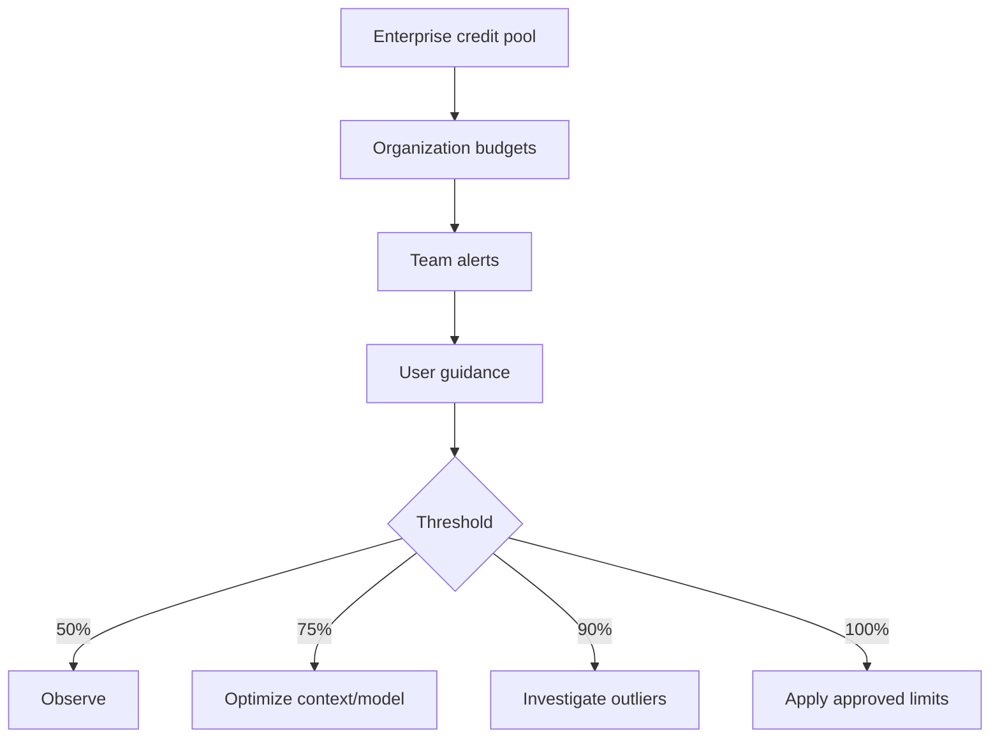

---
tags:
- github-copilot
- ai-controls
- ai-credits
- governance
- finops
lab:
  id: '094'
  level: L300
  journey: enterprise
  time_min: 90
  cost:
    tier: free-conditional
    requires: []
    estimate_usd: 0 within the documented free path or simulation.
    simulation: true
    cleanup: false
  roles:
  - admin
  - architect
  - finops
  - tech-lead
  technologies:
  - github-copilot
  - ai-controls
  - ai-credits
  - governance
  - finops
  status: active
  last_verified: '2026-10-27'
  languages:
  - en
  - pt
  - fr
---
# Lab 094: Governança e FinOps do Copilot: AI Controls, Políticas, Orçamentos e AI Credits

  <strong>Level:</strong> L300
  <strong>Jornada:</strong> enterprise
  <strong>Tempo:</strong> ~90 min
  <strong>Custo:</strong> Simulação grátis; caminho real pago

!!! info "Desenho gratuito primeiro"
    Conclua o exercício com Copilot Free ou com a simulação incluída. Recursos pagos são opcionais e marcados claramente.

!!! tip "Impacto em AI Credits"
    Baixo no exercício guiado; médio/alto em execuções agênticas ou repetidas. Prefira seleção automática de modelo, planeje antes de agir, mantenha o contexto focado e evite sessões paralelas desnecessárias.

## O que Você Aprenderá

- Mapear políticas do Copilot e AI Controls
- Projetar exclusão de conteúdo, auditoria e troubleshooting
- Estimar uso em AI Credits sem inventar cotas
- Criar orçamentos em camadas e playbooks de limiares

## Alinhamento GH-300

**Data and architecture (10–15%) · Privacy and safeguards (10–15%)**. Este mapeamento segue o recorte curricular GH-300 de **07/08/2026**. O escopo oficial pode manter termos antigos como “Copilot Edits”; este lab ensina a experiência atual e sinaliza a diferença.

## Mapa Conceitual

## Exercício Prático

### Etapa 1: Simulação grátis: matriz de políticas

Para cada persona, decida se completions, chat, CLI, MCP, cloud agent, code review e agentes terceiros são permitidos. Observe que controles enterprise não governam agentes locais do VS Code da mesma forma.

### Etapa 2: Simulação grátis: estimador de créditos

Classifique cargas como baixa, média ou alta. Estime `tokens de entrada × preço + tokens de saída × preço` e divida o valor em USD por 0,01 para obter AI Credits. Use preços atuais da documentação.

### Etapa 3: Projete orçamentos em camadas

Aloque pool enterprise, limites por organização, alertas por equipe e orientação ao usuário. Defina ações em 50%, 75%, 90% e 100%, investigando antes de restringir.

### Etapa 4: Caminho pago opcional

Em enterprise autorizado, reproduza a matriz em AI Controls, configure auditoria e allowlist MCP e compare uso real com a simulação.

## Simulação Grátis Completa de Governança

### Matriz de Políticas

| Persona | CLI | MCP | Cloud agent | Code review | Decisão |
|---|---:|---:|---:|---:|---|
| Estudante | Permitir | Servidores locais aprovados pelo usuário | Simular | Permitir se o repositório habilitar | Aprendizado gratuito |
| Desenvolvedor | Permitir | Allowlist do registry | Repositórios selecionados | Permitir | Engenharia padrão |
| Contratado | Condicional | Bloquear servidores desconhecidos | Bloquear | Permitir somente leitura | Limite de dados restrito |
| Admin de plataforma | Permitir | Gerenciar allowlist | Organizações selecionadas | Permitir | Administração auditada |

### Estimador de AI Credits

Use este cenário transparente:

| Carga | Tokens entrada | Tokens saída | Preço entrada / 1M | Preço saída / 1M | USD estimado | AI Credits |
|---|---:|---:|---:|---:|---:|---:|
| Chat focado | 8.000 | 1.000 | $1,00 | $4,00 | $0,012 | 1,2 |
| Plano de repositório | 60.000 | 4.000 | $1,00 | $4,00 | $0,076 | 7,6 |
| Sessão de agente | 250.000 | 20.000 | $1,00 | $4,00 | $0,330 | 33,0 |

Fórmula: `USD = tokens_entrada / 1.000.000 × preço_entrada + tokens_saída / 1.000.000 × preço_saída`; `AI Credits = USD / 0,01`.

Os preços são entradas ilustrativas do exercício, não promessa de preço atual. Substitua pela tabela oficial antes de uma decisão real.

## Kit de apoio

O build do site gera downloads estáveis em PDF e ZIP. O ZIP contém o guia do lab e todos os arquivos de apoio declarados para este lab.

- [Baixar PDF gerado](../downloads/kits/lab-094-kit-pt.pdf)
- [Baixar ZIP gerado](../downloads/kits/lab-094-kit-pt.zip)
